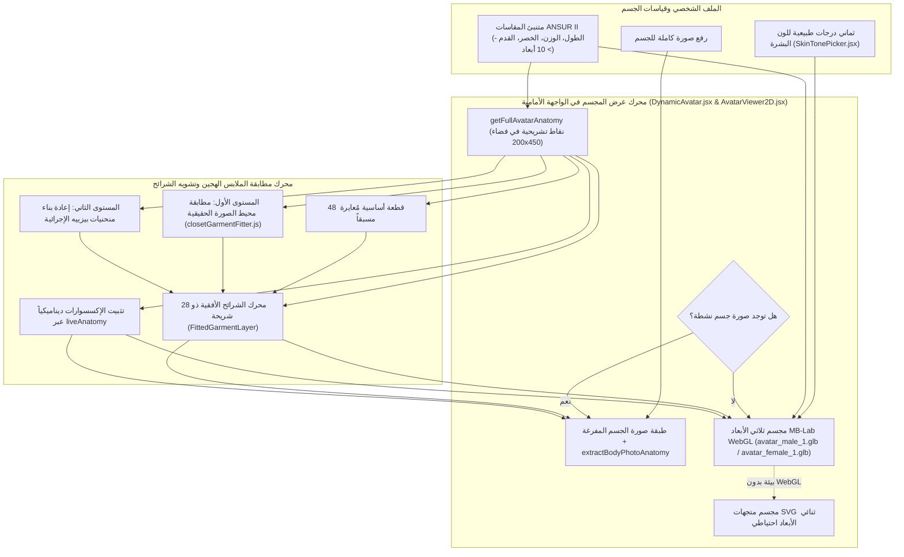

# DressApp — بنية المجسم الديناميكي ثلاثي الأبعاد ونظام مطابقة الملابس التشريحي (`Avatar.md`)

> **إصدار المستند:** 3.0  
> **النظام الفرعي المستهدف:** المجسم ثلاثي الأبعاد المبني بتقنية `MB-Lab WebGL`، وتفريغ صور الجسم الحقيقي، ومحرك مطابقة طبقات الملابس التشريحي  
> **الملفات الأساسية:** `DynamicAvatar.jsx` وكذلك `AvatarViewer2D.jsx` وكذلك `closetGarmentFitter.js` وكذلك `SkinTonePicker.jsx` وكذلك `fit_onboarding_garments_to_avatar.py` وكذلك `onboardingDataset.js`  
> **الحالة:** معتمد في بيئة الإنتاج ومعاير بالكامل  

---

## 1. الملخص التنفيذي والقيمة المقدمة للمستخدم

### 1.1 نظرة عامة عالية المستوى
يوفر **نظام المجسم الديناميكي ثلاثي الأبعاد ومطابقة الملابس في DressApp** بيئة قياس مرئية تفاعلية في الوقت الفعلي. يتيح النظام للمستخدمين معاينة قطع الملابس الرقمية في خزانتهم وقطع كبسولة البداية وهي مرتبة بدقة فوق **صورة جسم حقيقي مفرغة الخلفية** أو فوق **مجسم بشري ثلاثي الأبعاد عالي الواقعية (`MB-Lab`)** (`avatar_male_1.glb` وكذلك `avatar_female_1.glb`) يتم عرضه عبر `Three.js` وكذلك `React Three Fiber` داخل إطار عرض عمودي معاير بأبعاد `200 x 450` (مع دعم احتياطي تلقائي لمجسم متجهات `SVG` ثنائي الأبعاد).

ولتحقيق أعلى دقة بصرية عبر جميع فئات الملابس (القمصان، والسترات، والمعاطف، والبناطيل، والتنانير، والفساتين والأزياء التقليدية الكاملة، والأحذية، والإكسسوارات)، يجمع المحرك بين **النقاط التشريحية المستخرجة من المجسم ثلاثي الأبعاد**، و**محرك مطابقة الملابس الهجين ثنائي المستوى**، و**تشويه الشرائح الأفقية المباشر**.

### 1.2 القيمة المقدمة للمستخدم
* **مجسمات بشرية ثلاثية الأبعاد واقعية (`MB-Lab`)**: تستبدل الأشكال المسطحة بمجسمات ثلاثية الأبعاد واقعية للرجال (`avatar_male_1.glb`) والنساء (`avatar_female_1.glb`) تقف في وضعية مستقيمة وطبيعية مع تباعد خفيف بين القدمين وذراعين منسدلتين بمرونة تترك مسافة واضحة بين الكفين والوركين.
* **تشكيل ديناميكي للجسم وثماني درجات طبيعية للبشرة**: يستجيب المجسم فوراً لقياسات المستخدم (الطول، والوزن، والكتفين، والصدر، والخصر، والوركين) ولثماني درجات طبيعية للون البشرة وفق مقياس مونك (`#F6EDE4` إلى `#3A2518`) باستخدام مادة فيزيائية واقعية (`MeshPhysicalMaterial`).
* **إحداثيات دقيقة للملابس والإكسسوارات**: تُطابق جميع قطع كبسولة البداية البالغ عددها 48 قطعة وجميع ملابس خزانة المستخدم على إحداثيات المجسم ثلاثي الأبعاد بدقة — بما يشمل الذراعين الممتدتين (`wElbowOut` وكذلك `wWristOut`)، وعروض الجذع، والساقين المتباعدتين (`wOuterKnee` وكذلك `wOuterAnkle`)، والقدمين (`wFootTip` وكذلك `wFootHeel`).
* **مرونة التبديل الفوري**: إمكانية الانتقال الفوري بين صورة الجسم الحقيقية المفرغة والمجسم الديناميكي ثلاثي الأبعاد في أي وقت.

---

## 2. بنية المجسم ثلاثي الأبعاد (`DynamicAvatar.jsx`)

### 2.1 نماذج `Blender MB-Lab` ومعايرة الكاميرا العمودية
* **النماذج ثلاثية الأبعاد**:
  * مجسم الرجل: `apps/web/public/models/avatar_male_1.glb` (الارتفاع `1.7877` متر، وإزاحة الأرضية `ymin = -0.0061` متر)
  * مجسم المرأة: `apps/web/public/models/avatar_female_1.glb` (الارتفاع `1.6873` متر، وإزاحة الأرضية `ymin = -0.0061` متر)
* **الإسقاط العمودي (`Orthographic Projection`)**:
  * يُعرض عبر `<Canvas orthographic camera={{ zoom: 109, position: [0, 0, 5] }}>` داخل فضاء إحداثيات منطقي بأبعاد `200 x 450`.
  * عند معامل التكبير `zoom = 109`، يعادل كل متر واحد `109` وحدات رسم، بحيث يقع المركز الرأسي للوحة عند `Y = 225`.
* **فصل التحجيم الرأسي عن الأفقي (`Realistic3DAvatarMesh`)**:
  * يُحسب التحجيم الرأسي (`scaleY`) مباشرة من المعادلة `targetSvgHeight / (baseModelHeightM * 109)` ويرتكز عند خط القدمين (`yFeet`)، مما يضمن تطابقاً رأسياً تاماً مع `getFullAvatarAnatomy` لجميع الأطوال (`140` إلى `210` سنتيمترات).
  * يُحسب التحجيم الأفقي (`scaleX` وكذلك `scaleZ`) بشكل مستقل من النسب الموزونة لمحيط الصدر والخصر والوركين والكتفين (`scaleXZ`)، فلا يؤدي تغيير الطول إلى تشويه عرض الجذع أو الأطراف.

### 2.2 النقاط التشريحية في الإسقاط العمودي (`getFullAvatarAnatomy`)
من خلال مسح المضلعات المثلثية لملفي `avatar_male_1.glb` وكذلك `avatar_female_1.glb` داخل فضاء `200 x 450` بفاصل وحدة رأسية واحدة، توفر الدالة `getFullAvatarAnatomy` إحداثيات قياسية دقيقة تتغير ديناميكياً وفق نسب الطول والمحيطات:

| مجموعة النقاط التشريحية | القيم القياسية للرجل (`178` سم) | القيم القياسية للمرأة (`166` سم) | الوظيفة في النظام |
| --- | --- | --- | --- |
| **المناطق الرأسية للجذع** | `yChin: 58.5` وكذلك `yShoulders: 68.0` وكذلك `yChest: 100.0` وكذلك `yWaist: 138.0` وكذلك `yHip: 175.0` وكذلك `yCrotch: 190.0` | `yChin: 77.0` وكذلك `yShoulders: 87.0` وكذلك `yChest: 118.0` وكذلك `yWaist: 147.0` وكذلك `yHip: 185.0` وكذلك `yCrotch: 199.0` | الياقة، وخط الكتفين، والصدر، وحزام الخصر، والحوض، ونقطة تفرع الساقين |
| **المناطق الرأسية للأطراف** | `yElbow: 134.0` وكذلك `yWrist: 186.0` وكذلك `yKnees: 278.0` وكذلك `yAnkles: 356.0` وكذلك `yFeet: 382.0` | `yElbow: 148.0` وكذلك `yWrist: 195.0` وكذلك `yKnees: 282.0` وكذلك `yAnkles: 356.0` وكذلك `yFeet: 382.0` | أطراف الأكمام، والشورتات، والتنانير، والكاحلين، وموضع الأحذية |
| **أنصاف عروض الجذع** | `wNeck: 12.1` وكذلك `wShoulders: 38.6` وكذلك `wChest: 28.0` وكذلك `wWaist: 22.8` وكذلك `wHip: 25.8` | `wNeck: 10.5` وكذلك `wShoulders: 32.5` وكذلك `wChest: 24.4` وكذلك `wWaist: 19.6` وكذلك `wHip: 26.8` | فتحة العنق، وميل الكتفين، والدرزات الجانبية، وعرض الحوض |
| **حدود الذراعين الممتدتين** | `wElbowOut: 49.0` وكذلك `wElbowIn: 32.8` وكذلك `wWristOut: 61.0` وكذلك `wWristIn: 47.2` | `wElbowOut: 41.2` وكذلك `wElbowIn: 28.8` وكذلك `wWristOut: 53.0` وكذلك `wWristIn: 42.8` | مسارات الأكمام المائلة ومواضع الساعات والقفازات عند المعصم |
| **حدود الساقين والقدمين** | `wOuterKnee: 33.8` وكذلك `wInnerKnee: 16.5` وكذلك `wOuterAnkle: 37.8` وكذلك `wInnerAnkle: 26.2` وكذلك `wFootTip: 42.2` وكذلك `wFootHeel: 24.0` | `wOuterKnee: 31.8` وكذلك `wInnerKnee: 16.2` وكذلك `wOuterAnkle: 36.2` وكذلك `wInnerAnkle: 26.0` وكذلك `wFootTip: 40.2` وكذلك `wFootHeel: 23.0` | مسارات أرجل البناطيل، واتساع التنانير، ومربعات الأحذية اليمنى واليسرى |

---

## 3. محرك مطابقة الملابس الهجين وتشويه الشرائح المباشر

### 3.1 كبسولة البداية المعايرة مسبقاً (`scripts/fit_onboarding_garments_to_avatar.py`)
* يولّد جميع صور الملابس المفرغة البالغ عددها 48 قطعة (`*_fitted.png` وكذلك `.jpg` بدقة `900 x 1500`) في المجلد `apps/web/public/assets/onboarding/` مع بيانات `default_viewbox` وكذلك `point_cloud` داخل الملف `apps/web/src/lib/onboardingDataset.js`.
* يستخدم الدالة `compute_avatar_geometry` المتوافقة مع `getFullAvatarAnatomy` بحيث تتبع القمصان والمعاطف زاوية الذراعين للمجسم ثلاثي الأبعاد، وتتبع البناطيل محاور الساقين، وتنسدل التنانير فوق الساقين، وتستقر الأحذية مباشرة فوق القدمين.

### 3.2 محرك مطابقة ملابس الخزانة وقت التشغيل (`closetGarmentFitter.js`)
* **الغلاف التشريحي (`getGarmentAnatomicalEnvelope`)**: يحسب إطار العرض المستهدف (`default_viewbox`) والنقاط التشريحية لكل فئة ملابس.
* **المستوى الأول — مطابقة محيط الصورة الحقيقية (`warpRealGarmentPhotoToDefaultCanvas`)**:
  * يثبت القمصان والفساتين والمعاطف على خط العنق (`yNeckBase`) وعرض الكتفين (`shoulderSpan`) للمجسم ثلاثي الأبعاد، ويوجه الأكمام على امتداد زاوية الذراعين.
  * يضبط موضع البناطيل والتنانير بين الخصر والوركين وفق نوع القصة مع **حاجز تفرع صارم (`yCrotchTarget >= yCrotch`)**، ويوجه ساقي البنطال اليسرى واليمنى على طول مراكز الساقين من الورك حتى الكاحل.
  * يفصل صور أزواج الأحذية (`analyzeFootwearCutout`) بحيث توضع كل فردة حذاء فوق مركز القدم المقابل (`leftAnkleX` وكذلك `rightAnkleX`).
* **المستوى الثاني — إعادة البناء الإجرائية بمنحنيات بيزييه (`renderProceduralBezierFittedGarment`)**:
  * مولّد احتياطي يرسم محيط الملابس بانسيابية وفق إحداثيات الذراعين والجذع والساقين والقدمين للمجسم ثلاثي الأبعاد.

### 3.3 تشويه الشرائح الأفقية وتثبيت الإكسسوارات (`AvatarViewer2D.jsx`)
* **تشويه الشرائح الأفقية (`FittedGarmentLayer`)**:
  * يقسم كل قطعة ملابس مُعايرة إلى `28` شريحة أفقية عبر إطار `default_viewbox` الخاص بها.
  * يربط نقطة المنتصف الرأسية لكل شريحة (`y0Mid`) بالموضع الرأسي الحي للمستخدم (`mapBaselineYToLiveY`) ونسبة العرض الأفقي الحية (`getLiveWidthScaleAtY`)، مما يتيح تمدد الملابس وانكماشها بسلاسة مع تغير قياسات الجسم.
* **تثبيت الإكسسوارات ديناميكياً (`renderGarment`)**:
  * **أغطية الرأس**: تتمركز عند `X = 100` وترتكز على قمة الرأس (`yCrown` وكذلك `yHeadCenter`).
  * **النظارات**: توضع عند مستوى العينين (`yCrown + (yChin - yCrown) * 0.43`).
  * **الأقراط**: توضع عند مستوى شحمة الأذن (`yChin - 12` إلى `yChin + 10`).
  * **الأوشحة والقلائد وربطات العنق**: ترتكز عند قاعدة العنق (`yNeckBase`) وتتناسب مع عرض العنق والكتفين.
  * **الأحزمة**: تتمركز عند خط الخصر (`yWaist + (yHip - yWaist) * 0.22`) وفق عرض الخصر الحي.
  * **الساعات والأساور والقفازات**: ترتكز على إحداثيات المعصم للمجسم ثلاثي الأبعاد (`yWrist` وكذلك `wWristOut`).

---
*تتم صيانة هذا المستند بواسطة فريق هندسة DressApp.*
