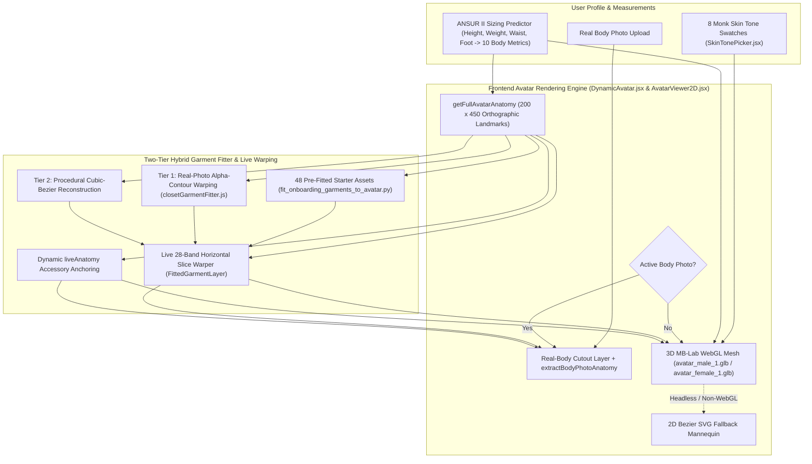

# DressApp — Architektur des dynamischen 3D-Avatars & Anprobe-Positionierungssystems (`Avatar.md`)

> **Dokumentversion:** 3.0  
> **Ziel-Subsystem:** Frontend 3D-MB-Lab-WebGL-Avatar, Echtkörper-Fotoausschnitte & anatomische Kleidungs-Overlay-Engine  
> **Kerndateien:** `DynamicAvatar.jsx`, `AvatarViewer2D.jsx`, `closetGarmentFitter.js`, `SkinTonePicker.jsx`, `fit_onboarding_garments_to_avatar.py`, `onboardingDataset.js`  
> **Status:** Produktiv veröffentlicht & kalibriert  

---

## 1. Management-Zusammenfassung & Nutzenversprechen

### 1.1 Überblick auf hoher Ebene
Das **dynamische 3D-Avatar- & Anprobe-Positionierungssystem von DressApp** bietet eine adaptive Echtzeit-Umgebung für die virtuelle Anprobe. Nutzer können digitalisierte Kleidungsstücke aus ihrem Kleiderschrank sowie Klassiker aus der Starter-Kapsel nahtlos geschichtet entweder auf einem **segmentierten Echtkörper-Foto** oder auf einem **realistischen menschlichen 3D-MB-Lab-Mesh** (`avatar_male_1.glb` und `avatar_female_1.glb`) betrachten, das über Three.js / React Three Fiber innerhalb einer kalibrierten orthografischen `200 x 450`-viewBox (mit automatischem 2D-Bézier-SVG-Fallback) gerendert wird.

Um über alle Kleidungskategorien hinweg (Oberteile, Hemden, Oberbekleidung, Hosen, Röcke, traditionelle/kulturelle Ganzkörperkleidung, Schuhe und Accessoires) höchste visuelle Präzision zu liefern, kombiniert die Engine **exakte orthografische 3D-Silhouetten-Landmarks**, einen **zweistufigen hybriden Kleidungs-Fitter** und **horizontales Live-Slice-Warping**.

### 1.2 Nutzenversprechen für den Anwender
* **Realistische menschliche 3D-MB-Lab-Meshes**: Ersetzt flache 2D-Silhouetten durch realistische männliche (`avatar_male_1.glb`) und weibliche (`avatar_female_1.glb`) 3D-Meshes in natürlicher aufrechter A-Stance-Haltung mit leicht gespreizten Füßen und locker herabhängenden Armen mit freiem Raum zwischen Handflächen und Hüften.
* **Dynamisches Körper-Morphing & 8 Monk-Hauttöne**: Reagiert in Echtzeit auf Benutzermaße (Größe, Gewicht, Schultern, Brust, Taille, Hüfte) und 8 realistische menschliche Hauttöne (`#F6EDE4` bis `#3A2518`) über einen physikalisch basierten Shader (`MeshPhysicalMaterial`).
* **3D-kalibrierte Kleidungs- & Accessoire-Koordinaten**: Projiziert alle 48 Starter-Kapsel-Kleidungsstücke und beliebige Schrank-Artikel des Nutzers auf die exakten 3D-Silhouetten-Koordinaten – einschließlich ausgestreckter Arme (`wElbowOut`, `wWristOut`), Oberkörperbreiten, A-Stance-Beine (`wOuterKnee`, `wOuterAnkle`) und gespreizter Füße (`wFootTip`, `wFootHeel`).
* **Dual-Avatar-Flexibilität**: Jederzeit nahtloser Wechsel zwischen einem persönlichen segmentierten Ganzkörperfoto und dem dynamischen 3D-Avatar.

---

## 2. 3D-Avatar-Architektur (`DynamicAvatar.jsx`)

### 2.1 Blender-MB-Lab-Assets & orthografische Kamerakalibrierung
* **Assets**:
  * Männliches Mesh: `apps/web/public/models/avatar_male_1.glb` (`height = 1.7877 m`, Boden-Offset `ymin = -0.0061 m`)
  * Weibliches Mesh: `apps/web/public/models/avatar_female_1.glb` (`height = 1.6873 m`, Boden-Offset `ymin = -0.0061 m`)
* **Orthografische Projektion**:
  * Gerendert über `<Canvas orthographic camera={{ zoom: 109, position: [0, 0, 5] }}>` innerhalb einer logischen `200 x 450`-viewBox (`aspect = 200 / 450`).
  * Bei `zoom = 109` gilt `1 Meter = 109 SVG-Einheiten`, wodurch die vertikale Mitte des `450`-Einheiten-Canvas bei `Y = 225` liegt.
* **Entkoppelte proportionale Skalierung (`Realistic3DAvatarMesh`)**:
  * Die vertikale Skalierung (`scaleY`) wird direkt aus `targetSvgHeight / (baseModelHeightM * 109)` berechnet und bei `yFeet` (`baseModelYMinM = -0.0061`) verankert, was eine 1:1-Vertikalausrichtung mit `getFullAvatarAnatomy` über alle Körpergrößen (`140 cm` bis `210 cm`) garantiert.
  * Die horizontale Skalierung (`scaleX`, `scaleZ`) wird unabhängig aus den gewichteten Verhältnissen von `chest`, `waist`, `hip` und `shoulders` relativ zu anthropometrischen Referenzmaßen (`scaleXZ`) berechnet, sodass Größenänderungen Oberkörper und Gliedmaßen nicht künstlich verbreitern oder verschmälern.

### 2.2 Orthografische 3D-Silhouetten-Landmarks (`getFullAvatarAnatomy`)
Durch Rasterisierung der Dreiecks-Meshes von `avatar_male_1.glb` und `avatar_female_1.glb` in den `200 x 450`-SVG-Koordinatenraum in vertikalen 1-Einheiten-Intervallen stellt `getFullAvatarAnatomy` exakte Referenz-Landmarks bereit (dynamisch skaliert durch `heightRatio` und Umfangsverhältnisse):

| Landmark-Gruppe | Referenz Mann (`178 cm`) | Referenz Frau (`166 cm`) | Zweck |
| --- | --- | --- | --- |
| **Vertikale Torso-Zonen** | `yChin: 58.5`, `yShoulders: 68.0`, `yChest: 100.0`, `yWaist: 138.0`, `yHip: 175.0`, `yCrotch: 190.0` | `yChin: 77.0`, `yShoulders: 87.0`, `yChest: 118.0`, `yWaist: 147.0`, `yHip: 185.0`, `yCrotch: 199.0` | Kragen, Schulternaht, Brust, Hosenbund, Becken und Schrittgabelung |
| **Vertikale Gliedmaßen-Zonen** | `yElbow: 134.0`, `yWrist: 186.0`, `yKnees: 278.0`, `yAnkles: 356.0`, `yFeet: 382.0` | `yElbow: 148.0`, `yWrist: 195.0`, `yKnees: 282.0`, `yAnkles: 356.0`, `yFeet: 382.0` | Kurz-/Dreiviertel-/Langarm-Säume, Shorts-/Midi-/Knöchel-Säume und Schuhplatzierung |
| **Torso-Halbbreiten** | `wNeck: 12.1`, `wShoulders: 38.6`, `wChest: 28.0`, `wWaist: 22.8`, `wHip: 25.8` | `wNeck: 10.5`, `wShoulders: 32.5`, `wChest: 24.4`, `wWaist: 19.6`, `wHip: 26.8` | Halsausschnitt, Schulterneigung, seitliche Torsonähte und Hüftfall |
| **Grenzen ausgestreckter Arme** | `wElbowOut: 49.0`, `wElbowIn: 32.8`, `wWristOut: 61.0`, `wWristIn: 47.2` | `wElbowOut: 41.2`, `wElbowIn: 28.8`, `wWristOut: 53.0`, `wWristIn: 42.8` | Abgewinkelte Ärmelkorridore sowie Handgelenk-/Uhren-/Handschuh-Anker |
| **A-Stance-Bein- & Fußgrenzen** | `wOuterKnee: 33.8`, `wInnerKnee: 16.5`, `wOuterAnkle: 37.8`, `wInnerAnkle: 26.2`, `wFootTip: 42.2`, `wFootHeel: 24.0` | `wOuterKnee: 31.8`, `wInnerKnee: 16.2`, `wOuterAnkle: 36.2`, `wInnerAnkle: 26.0`, `wFootTip: 40.2`, `wFootHeel: 23.0` | Hosenbeinröhren, Rocksäume sowie linke/rechte Schuh-Bounding-Boxen |

---

## 3. Zweistufiger hybrider Kleidungs-Fitter & Live-Slice-Warping

### 3.1 Vorangepasste Onboarding-Starter-Kapsel (`scripts/fit_onboarding_garments_to_avatar.py`)
* Generiert alle 48 transparenten RGBA-Ausschnitte (`*_fitted.png` und `.jpg` in $900 \times 1500$ Auflösung) in `apps/web/public/assets/onboarding/` zusammen mit `default_viewbox`- und `point_cloud`-Metadaten in `apps/web/src/lib/onboardingDataset.js`.
* Nutzt `compute_avatar_geometry` abgestimmt auf `getFullAvatarAnatomy`, sodass Oberteile/Jacken den ausgestreckten 3D-Armkorridoren (`wElbowOut`/`wWristOut`) folgen, Hosen/Jeans den A-Stance-Beinmitten (`legTopCenter` → `kneeCenter` → `ankleCenter`) folgen, Röcke sanft über die A-Stance-Waden fallen und Paarschuhe direkt über `(FootHeel..FootTip, yAnkles..yFeet)` sitzen.

### 3.2 Laufzeit-Kleiderschrank-Fitter (`closetGarmentFitter.js`)
* **Anatomische Hülle (`getGarmentAnatomicalEnvelope`)**: Berechnet den Ziel-Begrenzungsrahmen (`default_viewbox`) und die anatomischen Landmarks (`wElbowOut`, `wElbowIn`, `wWristOut`, `wWristIn`, `wOuterKnee`, `wInnerKnee`, `wOuterAnkle`, `wInnerAnkle`, `leftAnkleX`, `rightAnkleX`) für jede Kleidungskategorie.
* **Stufe 1 — Echtfoto-Alpha-Kontur-Warping (`warpRealGarmentPhotoToDefaultCanvas`)**:
  * Verankert Oberteile, Hemden, Kleider und Oberbekleidung am Halsausschnitt (`yNeckBase`) und der Schulterbreite (`shoulderSpan`) des 3D-Avatars und führt Ärmel sauber entlang des 3D-Armwinkels.
  * Positioniert Hosen/Röcke je nach Bundhöhe zwischen `yWaist` und `yHip` mit einer strikten **Schritt-Barriere (`yCrotchTarget >= yCrotch`)** und verschiebt linkes/rechtes Hosenbein entlang der A-Stance-Beinmitten des 3D-Avatars von der Hüfte bis zum Knöchel.
  * Trennt paarweise Schuhausschnitte (`analyzeFootwearCutout`), sodass linker und rechter Schuh auf `leftAnkleX` und `rightAnkleX` (`±(wFootTip + wFootHeel) / 2`) abgebildet werden.
* **Stufe 2 — Prozedurale Kubische-Bézier-Rekonstruktion (`renderProceduralBezierFittedGarment`)**:
  * Fallback-Silhouettengenerator mit kubischen Bézier-Pfaden, gebunden an die Arm-, Torso-, Bein- und Fußkoordinaten des 3D-Avatars.

### 3.3 Horizontales Live-Slice-Warping & Accessoire-Positionierung (`AvatarViewer2D.jsx`)
* **Horizontales Slice-Warping (`FittedGarmentLayer`)**:
  * Unterteilt jedes angepasste Kleidungsstück über seine `default_viewbox` hinweg in `28` horizontale Streifen (Slices).
  * Ordnet den vertikalen Referenz-Mittelpunkt jedes Streifens (`y0Mid`) der maßgemorphten vertikalen Live-Position (`mapBaselineYToLiveY`) und dem horizontalen Breitenverhältnis (`getLiveWidthScaleAtY`) des Nutzers zu, wodurch Kleidung über alle Körpergrößen und -breiten hinweg dynamisch gedehnt und positioniert wird.
* **Dynamische `liveAnatomy`-Accessoire-Verankerung (`renderGarment`)**:
  * **Kopfbedeckung**: Zentriert auf `X = 100`, verankert an `yCrown` und `yHeadCenter` (`width = wHead * 2.55`).
  * **Brillen**: Positioniert auf Augenhöhe (`yCrown + (yChin - yCrown) * 0.43`, `width = wHead * 1.95`).
  * **Ohrringe**: Positioniert am Ohrläppchen (`yChin - 12` bis `yChin + 10`, `width = wHead * 2.35`).
  * **Schal / Halsschmuck & Krawatte**: Verankert bei `yNeckBase` und skaliert über `wNeck` / `wShoulders`.
  * **Gürtel**: Zentriert bei `yWaist + (yHip - yWaist) * 0.22` mit `width = wWaist * 2.18`.
  * **Uhr / Armband & Handschuhe**: Verankert an den ausgestreckten 3D-Handgelenkkoordinaten (`yWrist`, `wWristOut`).

---
*Dokument gepflegt von DressApp Engineering.*
