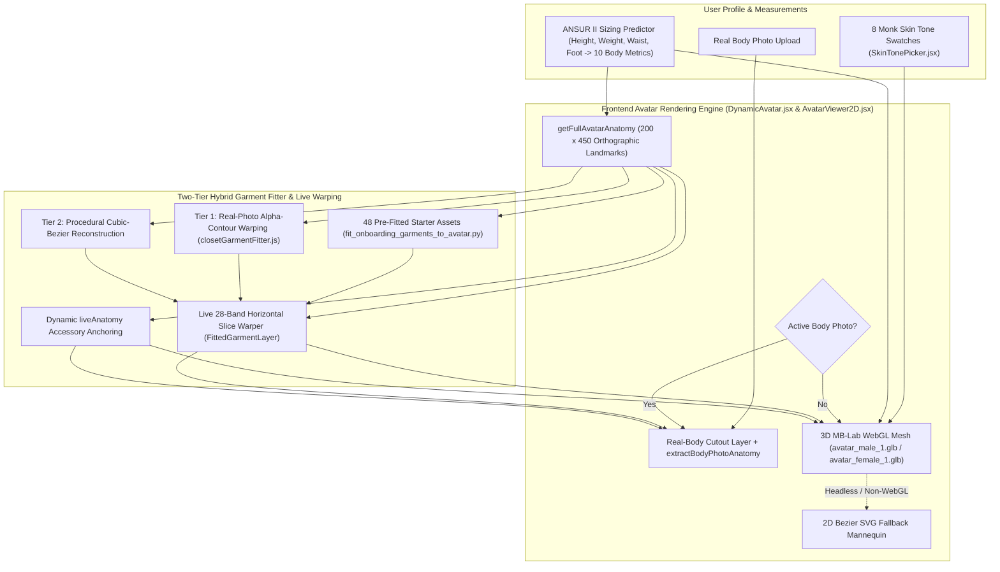

# DressApp — 3D Dynamic Avatar & Try-On Positioning System Architecture (`Avatar.md`)

> **Document Version:** 3.0  
> **Target Subsystem:** Frontend 3D MB-Lab WebGL Avatar, Real Body Photo Cutouts & Anatomical Garment Overlay Engine  
> **Core Files:** `DynamicAvatar.jsx`, `AvatarViewer2D.jsx`, `closetGarmentFitter.js`, `SkinTonePicker.jsx`, `fit_onboarding_garments_to_avatar.py`, `onboardingDataset.js`  
> **Status:** Production Shipped & Calibrated  

---

## 1. Executive Summary & Value Proposition

### 1.1 High-Level Overview
The **DressApp 3D Dynamic Avatar & Try-On Positioning System** provides an adaptive, real-time visual try-on environment. It allows users to preview digitized closet garments and starter capsule staples layered seamlessly on top of either a **segmented real-body photograph** or a **realistic 3D MB-Lab human mesh** (`avatar_male_1.glb` and `avatar_female_1.glb`) rendered via Three.js / React Three Fiber inside a calibrated `200 x 450` orthographic viewBox (with automatic 2D Bezier SVG fallback).

To deliver high visual accuracy across all garment categories (tops, shirts, outerwear, trousers, skirts, full-body cultural/traditional garments, footwear, and accessories), the engine combines **exact 3D orthographic silhouette landmarks**, a **two-tier hybrid garment fitter**, and **live horizontal slice warping**.

### 1.2 User Value Proposition
* **Realistic 3D MB-Lab Human Meshes**: Replaces flat 2D silhouettes with realistic 3D male (`avatar_male_1.glb`) and female (`avatar_female_1.glb`) meshes standing straight in a natural A-stance with slightly spread feet and relaxed arms leaving space between the palms and hips.
* **Dynamic Body Morphing & 8 Monk Skin Tones**: Responds in real time to user measurements (height, weight, shoulders, chest, waist, hips) and 8 realistic human skin tones (`#F6EDE4` through `#3A2518`) via a physically based (`MeshPhysicalMaterial`) shader.
* **3D-Calibrated Garment & Accessory Coordinates**: Maps all 48 starter capsule garments and arbitrary user closet items onto the exact 3D silhouette coordinates—including outstretched arms (`wElbowOut`, `wWristOut`), torso widths, A-stance legs (`wOuterKnee`, `wOuterAnkle`), and spread feet (`wFootTip`, `wFootHeel`).
* **Dual-Avatar Flexibility**: Switch seamlessly between a personal segmented full-body photo and the 3D dynamic avatar at any time.

---

## 2. 3D Avatar Architecture (`DynamicAvatar.jsx`)

### 2.1 Blender MB-Lab Assets & Orthographic Camera Calibration
* **Assets**:
  * Male mesh: `apps/web/public/models/avatar_male_1.glb` (`height = 1.7877 m`, floor offset `ymin = -0.0061 m`)
  * Female mesh: `apps/web/public/models/avatar_female_1.glb` (`height = 1.6873 m`, floor offset `ymin = -0.0061 m`)
* **Orthographic Projection**:
  * Rendered via `<Canvas orthographic camera={{ zoom: 109, position: [0, 0, 5] }}>` inside a `200 x 450` logical viewBox (`aspect = 200 / 450`).
  * At `zoom = 109`, `1 meter = 109 SVG units`, placing the vertical center of the `450`-unit canvas at `Y = 225`.
* **Decoupled Proportional Scaling (`Realistic3DAvatarMesh`)**:
  * Vertical scale (`scaleY`) is computed directly from `targetSvgHeight / (baseModelHeightM * 109)` and anchored at `yFeet` (`baseModelYMinM = -0.0061`), guaranteeing 1-to-1 vertical alignment with `getFullAvatarAnatomy` across all heights (`140 cm` to `210 cm`).
  * Horizontal scale (`scaleX`, `scaleZ`) is computed independently from the weighted ratios of `chest`, `waist`, `hip`, and `shoulders` relative to baseline anthropometric measurements (`scaleXZ`), preventing height changes from artificially widening or narrowing the torso and limbs.

### 2.2 3D Orthographic Silhouette Landmarks (`getFullAvatarAnatomy`)
By rasterizing the triangle meshes of `avatar_male_1.glb` and `avatar_female_1.glb` into the `200 x 450` SVG coordinate space at 1-unit vertical intervals, `getFullAvatarAnatomy` exposes exact baseline landmarks (scaled dynamically by `heightRatio` and circumference ratios):

| Landmark Group | Male Baseline (`178 cm`) | Female Baseline (`166 cm`) | Purpose |
| --- | --- | --- | --- |
| **Vertical Torso Zones** | `yChin: 58.5`, `yShoulders: 68.0`, `yChest: 100.0`, `yWaist: 138.0`, `yHip: 175.0`, `yCrotch: 190.0` | `yChin: 77.0`, `yShoulders: 87.0`, `yChest: 118.0`, `yWaist: 147.0`, `yHip: 185.0`, `yCrotch: 199.0` | Collar, shoulder seam, bust/chest, waistband, pelvis, and inseam bifurcation |
| **Vertical Limb Zones** | `yElbow: 134.0`, `yWrist: 186.0`, `yKnees: 278.0`, `yAnkles: 356.0`, `yFeet: 382.0` | `yElbow: 148.0`, `yWrist: 195.0`, `yKnees: 282.0`, `yAnkles: 356.0`, `yFeet: 382.0` | Short/3-quarter/long sleeve hems, shorts/midi/ankle hems, and shoe placement |
| **Torso Half-Widths** | `wNeck: 12.1`, `wShoulders: 38.6`, `wChest: 28.0`, `wWaist: 22.8`, `wHip: 25.8` | `wNeck: 10.5`, `wShoulders: 32.5`, `wChest: 24.4`, `wWaist: 19.6`, `wHip: 26.8` | Neckline opening, shoulder slope, torso side seams, and hip drape |
| **Outstretched Arm Bounds** | `wElbowOut: 49.0`, `wElbowIn: 32.8`, `wWristOut: 61.0`, `wWristIn: 47.2` | `wElbowOut: 41.2`, `wElbowIn: 28.8`, `wWristOut: 53.0`, `wWristIn: 42.8` | Angled sleeve corridors and wrist/watch/glove anchors |
| **A-Stance Leg & Foot Bounds** | `wOuterKnee: 33.8`, `wInnerKnee: 16.5`, `wOuterAnkle: 37.8`, `wInnerAnkle: 26.2`, `wFootTip: 42.2`, `wFootHeel: 24.0` | `wOuterKnee: 31.8`, `wInnerKnee: 16.2`, `wOuterAnkle: 36.2`, `wInnerAnkle: 26.0`, `wFootTip: 40.2`, `wFootHeel: 23.0` | Trouser leg tubes, skirt hems, and left/right footwear boxes |

---

## 3. Two-Tier Hybrid Garment Fitter & Live Slice Warping

### 3.1 Pre-Fitted Onboarding Starter Capsule (`scripts/fit_onboarding_garments_to_avatar.py`)
* Generates all 48 transparent RGBA cutouts (`*_fitted.png` and `.jpg` at $900 \times 1500$ resolution) in `apps/web/public/assets/onboarding/` along with `default_viewbox` and `point_cloud` metadata in `apps/web/src/lib/onboardingDataset.js`.
* Uses `compute_avatar_geometry` aligned with `getFullAvatarAnatomy` so tops/outerwear follow the 3D outstretched arm corridors (`wElbowOut`/`wWristOut`), trousers/jeans follow the A-stance leg centers (`legTopCenter` → `kneeCenter` → `ankleCenter`), skirts flare smoothly over the A-stance calves, and paired shoes sit directly over `(FootHeel..FootTip, yAnkles..yFeet)`.

### 3.2 Runtime Closet Garment Fitter (`closetGarmentFitter.js`)
* **Anatomical Envelope (`getGarmentAnatomicalEnvelope`)**: Computes the target bounding box (`default_viewbox`) and anatomical landmarks (`wElbowOut`, `wElbowIn`, `wWristOut`, `wWristIn`, `wOuterKnee`, `wInnerKnee`, `wOuterAnkle`, `wInnerAnkle`, `leftAnkleX`, `rightAnkleX`) for any garment category.
* **Tier 1 — Real-Photo Alpha-Contour Warping (`warpRealGarmentPhotoToDefaultCanvas`)**:
  * Anchors tops, shirts, dresses, and outerwear to the 3D avatar's neckline (`yNeckBase`) and shoulder width (`shoulderSpan`), mapping sleeves cleanly along the 3D arm angle.
  * Positions pants/skirts between `yWaist` and `yHip` according to rise style with a strict **Crotch Barrier (`yCrotchTarget >= yCrotch`)**, and translates left/right trouser legs along the 3D avatar's A-stance leg centers from hip to ankle.
  * Splits paired footwear cutouts (`analyzeFootwearCutout`) so left and right shoes map onto `leftAnkleX` and `rightAnkleX` (`±(wFootTip + wFootHeel) / 2`).
* **Tier 2 — Procedural Cubic-Bezier Reconstruction (`renderProceduralBezierFittedGarment`)**:
  * Fallback silhouette generator using Cubic-Bezier paths bound to the 3D avatar's arm, torso, leg, and foot coordinates.

### 3.3 Live Horizontal Slice Warping & Accessory Positioning (`AvatarViewer2D.jsx`)
* **Horizontal Slice Warping (`FittedGarmentLayer`)**:
  * Divides each fitted garment into `28` horizontal slices across its `default_viewbox`.
  * Maps every slice's baseline vertical midpoint (`y0Mid`) to the user's live measurement-morphed vertical position (`mapBaselineYToLiveY`) and horizontal width ratio (`getLiveWidthScaleAtY`), dynamically stretching and positioning garments across all body heights and widths.
* **Dynamic `liveAnatomy` Accessory Anchoring (`renderGarment`)**:
  * **Headwear**: Centered on `X = 100`, anchored to `yCrown` and `yHeadCenter` (`width = wHead * 2.55`).
  * **Glasses**: Positioned at eye level (`yCrown + (yChin - yCrown) * 0.43`, `width = wHead * 1.95`).
  * **Earrings**: Positioned from ear lobe (`yChin - 12` to `yChin + 10`, `width = wHead * 2.35`).
  * **Scarf / Neckwear & Necklace / Tie**: Anchored at `yNeckBase` and scaled by `wNeck` / `wShoulders`.
  * **Belt**: Centered at `yWaist + (yHip - yWaist) * 0.22` with `width = wWaist * 2.18`.
  * **Watch / Bracelet & Gloves**: Anchored to the outstretched 3D wrist coordinates (`yWrist`, `wWristOut`).

---
*Document maintained by DressApp Engineering.*
