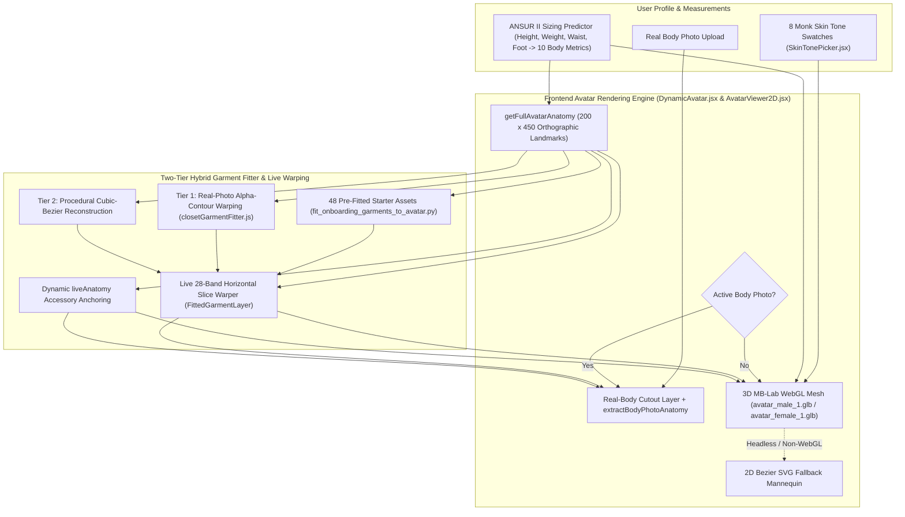

# DressApp — Arquitectura del Avatar Dinámico 3D y Sistema de Posicionamiento de Prueba Virtual (`Avatar.md`)

> **Versión del documento:** 3.0  
> **Subsistema objetivo:** Avatar Frontend 3D MB-Lab WebGL, recortes de fotos de cuerpo real y motor de superposición anatómica de prendas  
> **Archivos principales:** `DynamicAvatar.jsx`, `AvatarViewer2D.jsx`, `closetGarmentFitter.js`, `SkinTonePicker.jsx`, `fit_onboarding_garments_to_avatar.py`, `onboardingDataset.js`  
> **Estado:** En producción y calibrado  

---

## 1. Resumen ejecutivo y propuesta de valor

### 1.1 Descripción general de alto nivel
El **Sistema de Avatar Dinámico 3D y Posicionamiento de Prueba Virtual de DressApp** proporciona un entorno visual adaptativo en tiempo real. Permite a los usuarios previsualizar prendas digitalizadas de su armario y básicos de la cápsula inicial superpuestos de forma fluida sobre una **fotografía segmentada de cuerpo real** o sobre una **malla humana 3D MB-Lab realista** (`avatar_male_1.glb` y `avatar_female_1.glb`) renderizada mediante Three.js / React Three Fiber dentro de un viewBox ortográfico calibrado de `200 x 450` (con respaldo automático a maniquí vectorial SVG Bézier 2D).

Para ofrecer una alta precisión visual en todas las categorías de prendas (partes de arriba, camisas, abrigo, pantalones, faldas, prendas tradicionales/culturales de cuerpo entero, calzado y accesorios), el motor combina **puntos de referencia ortográficos 3D exactos**, un **ajustador híbrido de prendas de dos niveles** y **deformación por franjas horizontales en tiempo real**.

### 1.2 Propuesta de valor para el usuario
* **Mallas humanas 3D MB-Lab realistas**: Sustituye las siluetas planas en 2D por mallas 3D masculinas (`avatar_male_1.glb`) y femeninas (`avatar_female_1.glb`) realistas de pie en postura natural en A, con los pies ligeramente separados y los brazos relajados dejando espacio entre las palmas y las caderas.
* **Morfología corporal dinámica y 8 tonos de piel Monk**: Responde en tiempo real a las medidas del usuario (altura, peso, hombros, pecho, cintura, cadera) y a 8 tonos de piel humana realistas (`#F6EDE4` a `#3A2518`) mediante un sombreador basado en física (`MeshPhysicalMaterial`).
* **Coordenadas de prendas y accesorios calibradas en 3D**: Mapea las 48 prendas de la cápsula inicial y cualquier prenda del armario del usuario sobre las coordenadas exactas de la silueta 3D, incluyendo brazos extendidos (`wElbowOut`, `wWristOut`), anchos de torso, piernas en postura en A (`wOuterKnee`, `wOuterAnkle`) y pies separados (`wFootTip`, `wFootHeel`).
* **Flexibilidad de doble avatar**: Cambia sin interrupciones entre una foto personal de cuerpo entero segmentada y el avatar dinámico 3D en cualquier momento.

---

## 2. Arquitectura del Avatar 3D (`DynamicAvatar.jsx`)

### 2.1 Activos Blender MB-Lab y calibración de cámara ortográfica
* **Activos**:
  * Malla masculina: `apps/web/public/models/avatar_male_1.glb` (`height = 1.7877 m`, desplazamiento de suelo `ymin = -0.0061 m`)
  * Malla femenina: `apps/web/public/models/avatar_female_1.glb` (`height = 1.6873 m`, desplazamiento de suelo `ymin = -0.0061 m`)
* **Proyección ortográfica**:
  * Renderizado mediante `<Canvas orthographic camera={{ zoom: 109, position: [0, 0, 5] }}>` dentro de un viewBox lógico de `200 x 450` (`aspect = 200 / 450`).
  * Con `zoom = 109`, `1 metro = 109 unidades SVG`, situando el centro vertical del lienzo de `450` unidades en `Y = 225`.
* **Escalado proporcional desacoplado (`Realistic3DAvatarMesh`)**:
  * La escala vertical (`scaleY`) se calcula directamente a partir de `targetSvgHeight / (baseModelHeightM * 109)` y se ancla en `yFeet` (`baseModelYMinM = -0.0061`), garantizando una alineación vertical 1 a 1 con `getFullAvatarAnatomy` en todas las estaturas (`140 cm` a `210 cm`).
  * La escala horizontal (`scaleX`, `scaleZ`) se calcula de forma independiente a partir de las proporciones ponderadas de `chest`, `waist`, `hip` y `shoulders` en relación con las medidas antropométricas base (`scaleXZ`), evitando que los cambios de estatura ensanchen o estrechen artificialmente el torso y las extremidades.

### 2.2 Puntos anatómicos ortográficos 3D (`getFullAvatarAnatomy`)
Al rasterizar las mallas de triángulos de `avatar_male_1.glb` y `avatar_female_1.glb` en el espacio de coordenadas SVG de `200 x 450` a intervalos verticales de 1 unidad, `getFullAvatarAnatomy` expone puntos de referencia base exactos (escalados dinámicamente por `heightRatio` y proporciones de circunferencia):

| Grupo de referencia | Base Masculina (`178 cm`) | Base Femenina (`166 cm`) | Propósito |
| --- | --- | --- | --- |
| **Zonas verticales del torso** | `yChin: 58.5`, `yShoulders: 68.0`, `yChest: 100.0`, `yWaist: 138.0`, `yHip: 175.0`, `yCrotch: 190.0` | `yChin: 77.0`, `yShoulders: 87.0`, `yChest: 118.0`, `yWaist: 147.0`, `yHip: 185.0`, `yCrotch: 199.0` | Cuello, costura del hombro, pecho/busto, cintura, pelvis y bifurcación de entrepierna |
| **Zonas verticales de extremidades** | `yElbow: 134.0`, `yWrist: 186.0`, `yKnees: 278.0`, `yAnkles: 356.0`, `yFeet: 382.0` | `yElbow: 148.0`, `yWrist: 195.0`, `yKnees: 282.0`, `yAnkles: 356.0`, `yFeet: 382.0` | Dobladillos de manga corta/tres cuartos/larga, bajos de pantalón corto/midi/tobillo y calzado |
| **Semianchos del torso** | `wNeck: 12.1`, `wShoulders: 38.6`, `wChest: 28.0`, `wWaist: 22.8`, `wHip: 25.8` | `wNeck: 10.5`, `wShoulders: 32.5`, `wChest: 24.4`, `wWaist: 19.6`, `wHip: 26.8` | Abertura de escote, caída de hombros, costuras laterales del torso y caída de cadera |
| **Límites de brazos extendidos** | `wElbowOut: 49.0`, `wElbowIn: 32.8`, `wWristOut: 61.0`, `wWristIn: 47.2` | `wElbowOut: 41.2`, `wElbowIn: 28.8`, `wWristOut: 53.0`, `wWristIn: 42.8` | Corredores de manga en ángulo y anclajes de muñeca/reloj/guantes |
| **Límites de piernas en A y pies** | `wOuterKnee: 33.8`, `wInnerKnee: 16.5`, `wOuterAnkle: 37.8`, `wInnerAnkle: 26.2`, `wFootTip: 42.2`, `wFootHeel: 24.0` | `wOuterKnee: 31.8`, `wInnerKnee: 16.2`, `wOuterAnkle: 36.2`, `wInnerAnkle: 26.0`, `wFootTip: 40.2`, `wFootHeel: 23.0` | Tubos de pernera, bajos de falda y cajas de calzado izquierdo/derecho |

---

## 3. Ajustador híbrido de prendas de dos niveles y deformación por franjas en vivo

### 3.1 Cápsula inicial de onboarding preajustada (`scripts/fit_onboarding_garments_to_avatar.py`)
* Genera los 48 recortes RGBA transparentes (`*_fitted.png` y `.jpg` a resolución $900 \times 1500$) en `apps/web/public/assets/onboarding/` junto con los metadatos `default_viewbox` y `point_cloud` en `apps/web/src/lib/onboardingDataset.js`.
* Utiliza `compute_avatar_geometry` alineado con `getFullAvatarAnatomy` para que las partes superiores y abrigos sigan los corredores de brazos extendidos 3D (`wElbowOut`/`wWristOut`), los pantalones/vaqueros sigan los centros de pierna en postura en A (`legTopCenter` → `kneeCenter` → `ankleCenter`), las faldas caigan suavemente sobre las pantorrillas y los zapatos en par se sitúen directamente sobre `(FootHeel..FootTip, yAnkles..yFeet)`.

### 3.2 Ajustador de prendas del armario en tiempo de ejecución (`closetGarmentFitter.js`)
* **Envoltura anatómica (`getGarmentAnatomicalEnvelope`)**: Calcula el cuadro delimitador objetivo (`default_viewbox`) y los puntos anatómicos (`wElbowOut`, `wElbowIn`, `wWristOut`, `wWristIn`, `wOuterKnee`, `wInnerKnee`, `wOuterAnkle`, `wInnerAnkle`, `leftAnkleX`, `rightAnkleX`) para cualquier categoría de prenda.
* **Nivel 1 — Deformación de contorno alfa de foto real (`warpRealGarmentPhotoToDefaultCanvas`)**:
  * Ancla partes superiores, camisas, vestidos y abrigos a la base del cuello (`yNeckBase`) y al ancho de hombros (`shoulderSpan`) del avatar 3D, proyectando las mangas limpiamente a lo largo del ángulo del brazo 3D.
  * Posiciona pantalones y faldas entre `yWaist` e `yHip` según el tiro con una **barrera de entrepierna estricta (`yCrotchTarget >= yCrotch`)**, y traslada las perneras izquierda y derecha a lo largo de los centros de pierna en postura en A desde la cadera hasta el tobillo.
  * Divide los recortes de calzado en par (`analyzeFootwearCutout`) para que los zapatos izquierdo y derecho se sitúen en `leftAnkleX` y `rightAnkleX` (`±(wFootTip + wFootHeel) / 2`).
* **Nivel 2 — Reconstrucción procedimental Bézier cúbica (`renderProceduralBezierFittedGarment`)**:
  * Generador de siluetas de respaldo mediante trazados Bézier cúbicos vinculados a las coordenadas de brazos, torso, piernas y pies del avatar 3D.

### 3.3 Deformación de franjas horizontales en vivo y posicionamiento de accesorios (`AvatarViewer2D.jsx`)
* **Deformación de franjas horizontales (`FittedGarmentLayer`)**:
  * Divide cada prenda ajustada en `28` franjas horizontales a lo largo de su `default_viewbox`.
  * Asigna el punto medio vertical base de cada franja (`y0Mid`) a la posición vertical adaptada en vivo del usuario (`mapBaselineYToLiveY`) y a la proporción de ancho horizontal (`getLiveWidthScaleAtY`), estirando y posicionando dinámicamente las prendas en todas las estaturas y anchos corporales.
* **Anclaje dinámico de accesorios con `liveAnatomy` (`renderGarment`)**:
  * **Sombreros/Tocados**: Centrados en `X = 100`, anclados a `yCrown` e `yHeadCenter` (`width = wHead * 2.55`).
  * **Gafas**: Posicionadas al nivel de los ojos (`yCrown + (yChin - yCrown) * 0.43`, `width = wHead * 1.95`).
  * **Pendientes**: Posicionados desde el lóbulo de la oreja (`yChin - 12` a `yChin + 10`, `width = wHead * 2.35`).
  * **Bufanda / Cuello, Collar y Corbata**: Anclados en `yNeckBase` y escalados por `wNeck` / `wShoulders`.
  * **Cinturón**: Centrado en `yWaist + (yHip - yWaist) * 0.22` con `width = wWaist * 2.18`.
  * **Reloj / Pulsera y Guantes**: Anclados a las coordenadas 3D de la muñeca extendida (`yWrist`, `wWristOut`).

---
*Documento mantenido por DressApp Engineering.*
