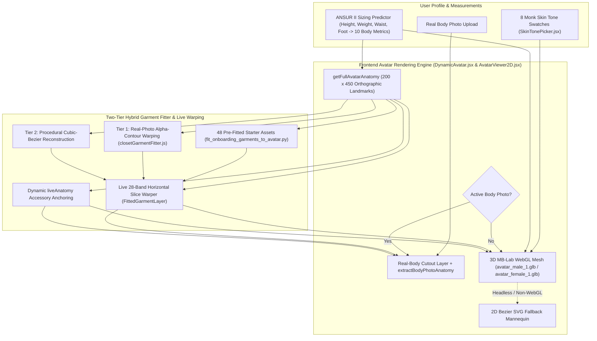

# DressApp — Architecture de l'Avatar Dynamique 3D et du Système de Positionnement d'Essayage (`Avatar.md`)

> **Version du document :** 3.0  
> **Sous-système cible :** Avatar Frontend 3D MB-Lab WebGL, découpes photo du corps réel et moteur de superposition anatomique des vêtements  
> **Fichiers principaux :** `DynamicAvatar.jsx`, `AvatarViewer2D.jsx`, `closetGarmentFitter.js`, `SkinTonePicker.jsx`, `fit_onboarding_garments_to_avatar.py`, `onboardingDataset.js`  
> **Statut :** En production et calibré  

---

## 1. Résumé exécutif et proposition de valeur

### 1.1 Vue d'ensemble
Le **Système d'Avatar Dynamique 3D et de Positionnement d'Essayage de DressApp** fournit un environnement d'essayage visuel adaptatif en temps réel. Il permet aux utilisateurs de prévisualiser les vêtements numérisés de leur garde-robe ainsi que les essentiels de la capsule de départ superposés de manière fluide sur une **photographie en pied segmentée** ou sur un **maillage humain 3D MB-Lab réaliste** (`avatar_male_1.glb` et `avatar_female_1.glb`) rendu via Three.js / React Three Fiber dans une viewBox orthographique calibrée de `200 x 450` (avec repli automatique sur un mannequin vectoriel SVG Bézier 2D).

Pour offrir une haute précision visuelle dans toutes les catégories de vêtements (hauts, chemises, vêtements d'extérieur, pantalons, jupes, tenues traditionnelles/culturelles complètes, chaussures et accessoires), le moteur combine **des repères de silhouette orthographiques 3D exacts**, un **ajusteur de vêtements hybride à deux niveaux** et un **découpage horizontal dynamique (slice warping)**.

### 1.2 Proposition de valeur pour l'utilisateur
* **Maillages humains 3D MB-Lab réalistes** : Remplace les silhouettes 2D plates par des maillages 3D masculin (`avatar_male_1.glb`) et féminin (`avatar_female_1.glb`) réalistes debout dans une posture en A naturelle, les pieds légèrement écartés et les bras relâchés laissant un espace entre les paumes et les hanches.
* **Morphing corporel dynamique et 8 carnations Monk** : Réagit en temps réel aux mensurations de l'utilisateur (taille, poids, épaules, poitrine, tour de taille, hanches) et à 8 teintes de peau humaine réalistes (`#F6EDE4` à `#3A2518`) via un shader physique (`MeshPhysicalMaterial`).
* **Coordonnées de vêtements et d'accessoires calibrées en 3D** : Projette les 48 vêtements de la capsule de départ et tous les articles du dressing de l'utilisateur sur les coordonnées exactes de la silhouette 3D — y compris les bras écartés (`wElbowOut`, `wWristOut`), les largeurs du torse, les jambes en posture en A (`wOuterKnee`, `wOuterAnkle`) et les pieds écartés (`wFootTip`, `wFootHeel`).
* **Flexibilité double avatar** : Basculez à tout moment entre une photo personnelle en pied détourée et l'avatar dynamique 3D.

---

## 2. Architecture de l'Avatar 3D (`DynamicAvatar.jsx`)

### 2.1 Modèles Blender MB-Lab et calibration de la caméra orthographique
* **Modèles 3D** :
  * Maillage masculin : `apps/web/public/models/avatar_male_1.glb` (`height = 1.7877 m`, décalage au sol `ymin = -0.0061 m`)
  * Maillage féminin : `apps/web/public/models/avatar_female_1.glb` (`height = 1.6873 m`, décalage au sol `ymin = -0.0061 m`)
* **Projection orthographique** :
  * Rendu via `<Canvas orthographic camera={{ zoom: 109, position: [0, 0, 5] }}>` dans une viewBox logique `200 x 450` (`aspect = 200 / 450`).
  * À `zoom = 109`, `1 mètre = 109 unités SVG`, plaçant le centre vertical du canevas de `450` unités à `Y = 225`.
* **Mise à l'échelle proportionnelle découplée (`Realistic3DAvatarMesh`)** :
  * L'échelle verticale (`scaleY`) est calculée directement à partir de `targetSvgHeight / (baseModelHeightM * 109)` et ancrée à `yFeet` (`baseModelYMinM = -0.0061`), garantissant un alignement vertical 1:1 avec `getFullAvatarAnatomy` pour toutes les statures (`140 cm` à `210 cm`).
  * L'échelle horizontale (`scaleX`, `scaleZ`) est calculée indépendamment à partir des ratios pondérés de `chest`, `waist`, `hip` et `shoulders` par rapport aux mesures anthropométriques de référence (`scaleXZ`), évitant que les changements de taille n'élargissent ou ne rétrécissent artificiellement le torse et les membres.

### 2.2 Repères de silhouette orthographiques 3D (`getFullAvatarAnatomy`)
En rastérisant les maillages triangulaires de `avatar_male_1.glb` et `avatar_female_1.glb` dans l'espace de coordonnées SVG `200 x 450` par intervalles verticaux de 1 unité, `getFullAvatarAnatomy` expose des repères de base exacts (mis à l'échelle dynamiquement selon `heightRatio` et les ratios de circonférence) :

| Groupe de repères | Référence Homme (`178 cm`) | Référence Femme (`166 cm`) | Rôle |
| --- | --- | --- | --- |
| **Zones verticales du torse** | `yChin: 58.5`, `yShoulders: 68.0`, `yChest: 100.0`, `yWaist: 138.0`, `yHip: 175.0`, `yCrotch: 190.0` | `yChin: 77.0`, `yShoulders: 87.0`, `yChest: 118.0`, `yWaist: 147.0`, `yHip: 185.0`, `yCrotch: 199.0` | Col, couture d'épaule, poitrine/buste, ceinture, bassin et bifurcation d'entrejambe |
| **Zones verticales des membres** | `yElbow: 134.0`, `yWrist: 186.0`, `yKnees: 278.0`, `yAnkles: 356.0`, `yFeet: 382.0` | `yElbow: 148.0`, `yWrist: 195.0`, `yKnees: 282.0`, `yAnkles: 356.0`, `yFeet: 382.0` | Ourlets de manches courtes/3-quarts/longues, ourlets shorts/midi/chevilles et chaussures |
| **Demi-largeurs du torse** | `wNeck: 12.1`, `wShoulders: 38.6`, `wChest: 28.0`, `wWaist: 22.8`, `wHip: 25.8` | `wNeck: 10.5`, `wShoulders: 32.5`, `wChest: 24.4`, `wWaist: 19.6`, `wHip: 26.8` | Ouverture d'encolure, pente d'épaule, coutures latérales du torse et tombé des hanches |
| **Limites des bras écartés** | `wElbowOut: 49.0`, `wElbowIn: 32.8`, `wWristOut: 61.0`, `wWristIn: 47.2` | `wElbowOut: 41.2`, `wElbowIn: 28.8`, `wWristOut: 53.0`, `wWristIn: 42.8` | Couloirs de manches inclinés et points d'ancrage poignet/montre/gants |
| **Limites jambes en A et pieds** | `wOuterKnee: 33.8`, `wInnerKnee: 16.5`, `wOuterAnkle: 37.8`, `wInnerAnkle: 26.2`, `wFootTip: 42.2`, `wFootHeel: 24.0` | `wOuterKnee: 31.8`, `wInnerKnee: 16.2`, `wOuterAnkle: 36.2`, `wInnerAnkle: 26.0`, `wFootTip: 40.2`, `wFootHeel: 23.0` | Jambes de pantalon, ourlets de jupe et boîtes de chaussures gauche/droite |

---

## 3. Ajusteur hybride à deux niveaux et déformation par tranches en temps réel

### 3.1 Capsule de départ d'onboarding pré-ajustée (`scripts/fit_onboarding_garments_to_avatar.py`)
* Génère les 48 découpes RGBA transparentes (`*_fitted.png` et `.jpg` en résolution $900 \times 1500$) dans `apps/web/public/assets/onboarding/` ainsi que les métadonnées `default_viewbox` et `point_cloud` dans `apps/web/src/lib/onboardingDataset.js`.
* Utilise `compute_avatar_geometry` aligné sur `getFullAvatarAnatomy` pour que les hauts et vestes suivent les couloirs des bras 3D (`wElbowOut`/`wWristOut`), que les pantalons et jeans suivent les centres des jambes en posture en A (`legTopCenter` → `kneeCenter` → `ankleCenter`), que les jupes s'évasent harmonieusement sur les mollets et que les paires de chaussures se placent directement sur `(FootHeel..FootTip, yAnkles..yFeet)`.

### 3.2 Ajusteur de vêtements du dressing à l'exécution (`closetGarmentFitter.js`)
* **Enveloppe anatomique (`getGarmentAnatomicalEnvelope`)** : Calcule la boîte englobante cible (`default_viewbox`) et les repères anatomiques (`wElbowOut`, `wElbowIn`, `wWristOut`, `wWristIn`, `wOuterKnee`, `wInnerKnee`, `wOuterAnkle`, `wInnerAnkle`, `leftAnkleX`, `rightAnkleX`) pour chaque catégorie de vêtement.
* **Niveau 1 — Déformation de contour alpha sur photo réelle (`warpRealGarmentPhotoToDefaultCanvas`)** :
  * Ancre les hauts, chemises, robes et vêtements d'extérieur à la base du cou (`yNeckBase`) et à la carrure (`shoulderSpan`) de l'avatar 3D, en orientant proprement les manches selon l'angle des bras 3D.
  * Positionne les pantalons et jupes entre `yWaist` et `yHip` selon la hauteur de taille avec une **barrière d'entrejambe stricte (`yCrotchTarget >= yCrotch`)**, et aligne les jambes gauche et droite du pantalon le long des centres de jambes en posture en A de la hanche à la cheville.
  * Sépare les découpes de paires de chaussures (`analyzeFootwearCutout`) afin que les chaussures gauche et droite soient projetées sur `leftAnkleX` et `rightAnkleX` (`±(wFootTip + wFootHeel) / 2`).
* **Niveau 2 — Reconstruction procédurale par courbes de Bézier cubiques (`renderProceduralBezierFittedGarment`)** :
  * Générateur de silhouettes de repli utilisant des tracés de Bézier cubiques liés aux coordonnées des bras, du torse, des jambes et des pieds de l'avatar 3D.

### 3.3 Déformation par tranches horizontales en direct et positionnement des accessoires (`AvatarViewer2D.jsx`)
* **Déformation par tranches horizontales (`FittedGarmentLayer`)** :
  * Divise chaque vêtement ajusté en `28` tranches horizontales sur sa `default_viewbox`.
  * Associe le point médian vertical de référence de chaque tranche (`y0Mid`) à la position verticale dynamique morphée de l'utilisateur (`mapBaselineYToLiveY`) et au ratio de largeur horizontale (`getLiveWidthScaleAtY`), étirant et positionnant dynamiquement les vêtements pour toutes les tailles et morphologies.
* **Ancrage dynamique des accessoires via `liveAnatomy` (`renderGarment`)** :
  * **Couvre-chefs** : Centrés sur `X = 100`, ancrés à `yCrown` et `yHeadCenter` (`width = wHead * 2.55`).
  * **Lunettes** : Positionnées au niveau des yeux (`yCrown + (yChin - yCrown) * 0.43`, `width = wHead * 1.95`).
  * **Boucles d'oreilles** : Positionnées au lobe d'oreille (`yChin - 12` à `yChin + 10`, `width = wHead * 2.35`).
  * **Écharpe / Tour de cou, Collier et Cravate** : Ancrés à `yNeckBase` et mis à l'échelle selon `wNeck` / `wShoulders`.
  * **Ceinture** : Centrée à `yWaist + (yHip - yWaist) * 0.22` avec `width = wWaist * 2.18`.
  * **Montre / Bracelet et Gants** : Ancrés aux coordonnées 3D des poignets écartés (`yWrist`, `wWristOut`).

---
*Document maintenu par DressApp Engineering.*
