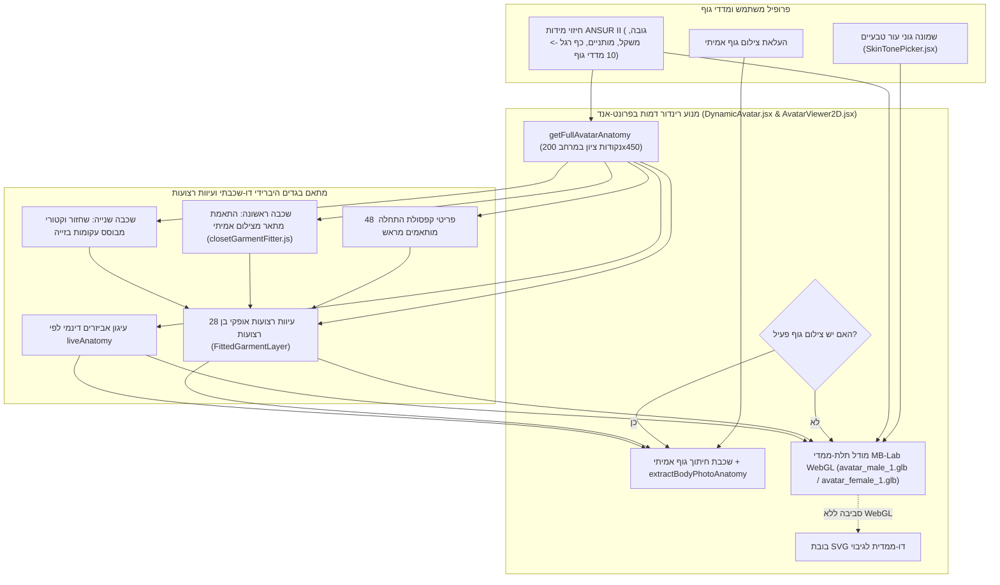

# DressApp — ארכיטקטורת דמות תלת-ממדית דינמית ומערכת מיפוי לבוש אנטומית (`Avatar.md`)

> **גרסת מסמך:** 3.0  
> **תת-מערכת יעד:** דמות תלת-ממדית מבוססת `MB-Lab WebGL`, חיתוך צילום גוף אמיתי ומנוע מיפוי שכבות לבוש אנטומי  
> **קבצי ליבה:** `DynamicAvatar.jsx` וכן `AvatarViewer2D.jsx` וכן `closetGarmentFitter.js` וכן `SkinTonePicker.jsx` וכן `fit_onboarding_garments_to_avatar.py` וכן `onboardingDataset.js`  
> **סטטוס:** פעיל בייצור ומכויל במלואו  

---

## 1. תקציר מנהלים וערך למשתמש

### 1.1 סקירה כללית
**מערכת הדמות התלת-ממדית הדינמית ומיפוי הלבוש של DressApp** מספקת סביבת מדידה חזותית אינטראקטיבית בזמן אמת. המערכת מאפשרת למשתמשים לצפות בפריטי לבוש מהארון הדיגיטלי ובפריטי קפסולת ההתחלה כשהם מולבשים בצורה מדויקת מעל **צילום מופרד של גוף אמיתי** או מעל **דמות תלת-ממדית ריאליסטית מסוג `MB-Lab`** (`avatar_male_1.glb` וכן `avatar_female_1.glb`) המרונדרת באמצעות `Three.js` וכן `React Three Fiber` במרחב תצוגה אורתוגרפי מכויל של `200 x 450` (עם גיבוי אוטומטי של בובת `SVG` דו-ממדית).

כדי להשיג דיוק חזותי מרבי בכל קטגוריות הלבוש (חולצות, סריגים, מעילים, מכנסיים, חצאיות, שמלות ולבוש מסורתי ארוך, הנעלה ואביזרים), המנוע משלב **נקודות ציון אנטומיות שהופקו מהמודל התלת-ממדי**, **מתאם בגדים היברידי דו-שכבתי** ו**עיוות רצועות אופקי בזמן אמת**.

### 1.2 הצעת ערך למשתמש
* **דמויות תלת-ממדיות ריאליסטיות (`MB-Lab`)**: מחליפות את הצלליות הדו-ממדיות השטוחות במודלים תלת-ממדיים ריאליסטיים לגבר (`avatar_male_1.glb`) ולאישה (`avatar_female_1.glb`) העומדים זקוף בעמידת `A` טבעית עם כפות רגליים פשוקות מעט וזרועות משוחררות לצדי הגוף עם מרווח בין כפות הידיים לירכיים.
* **שינוי פרופורציות דינמי ושמונה גוני עור טבעיים**: הדמות מגיבה בזמן אמת למידות המשתמש (גובה, משקל, כתפיים, חזה, מותניים וירכיים) ולשמונה גוני עור טבעיים לפי סולם מונק (`#F6EDE4` עד `#3A2518`) באמצעות חומר פיזיקלי ריאליסטי (`MeshPhysicalMaterial`).
* **מיפוי קואורדינטות מדויק לבגדים ולאביזרים**: כל 48 פריטי קפסולת ההתחלה וכל פריטי הארון של המשתמש ממופים לקואורדינטות המדויקות של הצללית התלת-ממדית — כולל הזרועות הפרושות (`wElbowOut` וכן `wWristOut`), רוחבי הגו, הרגליים הפשוקות (`wOuterKnee` וכן `wOuterAnkle`) וכפות הרגליים (`wFootTip` וכן `wFootHeel`).
* **גמישות מלאה בין דמות תלת-ממדית לצילום אישי**: מעבר חלק ומיידי בין תמונת גוף מלא אישית לבין הדמות התלת-ממדית הדינמית בכל עת.

---

## 2. ארכיטקטורת הדמות התלת-ממדית (`DynamicAvatar.jsx`)

### 2.1 מודלי `Blender MB-Lab` וכיול מצלמה אורתוגרפית
* **נכסי תלת-ממד**:
  * מודל גבר: `apps/web/public/models/avatar_male_1.glb` (גובה `1.7877` מטרים, היסט רצפה `ymin = -0.0061` מטרים)
  * מודל אישה: `apps/web/public/models/avatar_female_1.glb` (גובה `1.6873` מטרים, היסט רצפה `ymin = -0.0061` מטרים)
* **הטלה אורתוגרפית**:
  * מרונדר באמצעות `<Canvas orthographic camera={{ zoom: 109, position: [0, 0, 5] }}>` בתוך תיבת תצוגה לוגית של `200 x 450`.
  * ברמת תקריב `zoom = 109`, כל מטר אחד שווה לערך של `109` יחידות תצוגה, כאשר מרכז הציר האנכי נמצא בנקודה `Y = 225`.
* **שינוי קנה מידה מופרד (`Realistic3DAvatarMesh`)**:
  * קנה המידה האנכי (`scaleY`) מחושב ישירות מתוך `targetSvgHeight / (baseModelHeightM * 109)` ומעוגן לקו כפות הרגליים (`yFeet`), מה שמבטיח התאמה אנכית מדויקת מול `getFullAvatarAnatomy` בכל גובה (`140` עד `210` סנטימטרים).
  * קנה המידה האופקי (`scaleX` וכן `scaleZ`) מחושב בנפרד מתוך היחס המשוקלל של היקפי החזה, המותניים, הירכיים והכתפיים (`scaleXZ`), כך ששינוי גובה אינו מעוות את רוחב הגוף.

### 2.2 נקודות ציון אנטומיות במרחב האורתוגרפי (`getFullAvatarAnatomy`)
באמצעות דגימת רשת המשולשים של `avatar_male_1.glb` וכן `avatar_female_1.glb` למרחב `200 x 450` במרווחים של יחידה אנכית אחת, הפונקציה `getFullAvatarAnatomy` מפיקה נקודות ציון מדויקות המשתנות דינמית לפי יחסי הגובה וההיקפים:

| קבוצת נקודות ציון | ערכי בסיס לגבר (`178` ס"מ) | ערכי בסיס לאישה (`166` ס"מ) | ייעוד במערכת |
| --- | --- | --- | --- |
| **אזורי גו אנכיים** | `yChin: 58.5` וכן `yShoulders: 68.0` וכן `yChest: 100.0` וכן `yWaist: 138.0` וכן `yHip: 175.0` וכן `yCrotch: 190.0` | `yChin: 77.0` וכן `yShoulders: 87.0` וכן `yChest: 118.0` וכן `yWaist: 147.0` וכן `yHip: 185.0` וכן `yCrotch: 199.0` | צווארון, תפר כתפיים, חזה, חגורת מותן, אגן והתפצלות המפשעה |
| **אזורי גפיים אנכיים** | `yElbow: 134.0` וכן `yWrist: 186.0` וכן `yKnees: 278.0` וכן `yAnkles: 356.0` וכן `yFeet: 382.0` | `yElbow: 148.0` וכן `yWrist: 195.0` וכן `yKnees: 282.0` וכן `yAnkles: 356.0` וכן `yFeet: 382.0` | מכפלות שרוולים, מכנסיים קצרים, חצאיות, קרסוליים ומיקום נעליים |
| **חצאי רוחב גו** | `wNeck: 12.1` וכן `wShoulders: 38.6` וכן `wChest: 28.0` וכן `wWaist: 22.8` וכן `wHip: 25.8` | `wNeck: 10.5` וכן `wShoulders: 32.5` וכן `wChest: 24.4` וכן `wWaist: 19.6` וכן `wHip: 26.8` | מפתח צוואר, שיפוע כתפיים, תפרי צד ורוחב אגן |
| **גבולות זרועות פרושות** | `wElbowOut: 49.0` וכן `wElbowIn: 32.8` וכן `wWristOut: 61.0` וכן `wWristIn: 47.2` | `wElbowOut: 41.2` וכן `wElbowIn: 28.8` וכן `wWristOut: 53.0` וכן `wWristIn: 42.8` | זווית שרוולים ועיגון שעונים וכפפות בפרק כף היד |
| **גבולות רגליים וכפות רגליים** | `wOuterKnee: 33.8` וכן `wInnerKnee: 16.5` וכן `wOuterAnkle: 37.8` וכן `wInnerAnkle: 26.2` וכן `wFootTip: 42.2` וכן `wFootHeel: 24.0` | `wOuterKnee: 31.8` וכן `wInnerKnee: 16.2` וכן `wOuterAnkle: 36.2` וכן `wInnerAnkle: 26.0` וכן `wFootTip: 40.2` וכן `wFootHeel: 23.0` | שרוולי מכנסיים בעמידת `A`, מפתח חצאיות ותיבות נעליים לימין ולשמאל |

---

## 3. מתאם בגדים היברידי דו-שכבתי ועיוות רצועות חי

### 3.1 קפסולת ההתחלה המותאמת מראש (`scripts/fit_onboarding_garments_to_avatar.py`)
* מייצר את כל 48 התמונות השקופות (`*_fitted.png` וכן `.jpg` ברזולוציית `900 x 1500`) בתיקייה `apps/web/public/assets/onboarding/` לצד נתוני `default_viewbox` וכן `point_cloud` בקובץ `apps/web/src/lib/onboardingDataset.js`.
* משתמש בפונקציה `compute_avatar_geometry` המסונכרנת עם `getFullAvatarAnatomy` כך שחולצות ומעילים עוקבים אחר זווית הזרועות של הדמות התלת-ממדית, מכנסיים עוקבים אחר צירי הרגליים בעמידת `A`, חצאיות מתרחבות מעל השוקיים וזוגות נעליים מתיישבים בדיוק על כפות הרגליים.

### 3.2 מתאם בגדי הארון בזמן ריצה (`closetGarmentFitter.js`)
* **מעטפת אנטומית (`getGarmentAnatomicalEnvelope`)**: מחשבת את תיבת התצוגה (`default_viewbox`) ונקודות הציון האנטומיות לכל קטגוריית לבוש.
* **שכבה ראשונה — התאמת מתאר מצילום אמיתי (`warpRealGarmentPhotoToDefaultCanvas`)**:
  * מעגנת חולצות, שמלות ומעילים לקו הצוואר (`yNeckBase`) ולרוחב הכתפיים (`shoulderSpan`) של הדמות התלת-ממדית, ומיישרת את השרוולים לאורך זווית הזרועות.
  * ממקמת מכנסיים וחצאיות בין המותניים לירכיים לפי סגנון הגזרה עם **מחסום מפשעה קשיח (`yCrotchTarget >= yCrotch`)**, ומסיטה את שרוולי המכנס השמאלי והימני לאורך מרכזי הרגליים בעמידת `A`.
  * מפצלת צילומי זוגות נעליים (`analyzeFootwearCutout`) כך שכל נעל ממופה למרכז כף הרגל המתאימה (`leftAnkleX` וכן `rightAnkleX`).
* **שכבה שנייה — שחזור וקטורי מבוסס עקומות בזייה (`renderProceduralBezierFittedGarment`)**:
  * מנוע גיבוי המייצר צללית בגד חלקה לפי קואורדינטות הזרועות, הגו, הרגליים וכפות הרגליים של הדמות התלת-ממדית.

### 3.3 עיוות רצועות אופקי ומיקום אביזרים (`AvatarViewer2D.jsx`)
* **עיוות רצועות אופקי (`FittedGarmentLayer`)**:
  * מחלק כל בגד מותאם לסה"כ `28` רצועות אופקיות לאורך תיבת `default_viewbox` שלו.
  * ממפה את נקודת האמצע האנכית של כל רצועה (`y0Mid`) למיקום האנכי החי של המשתמש (`mapBaselineYToLiveY`) וליחס הרוחב האופקי החי (`getLiveWidthScaleAtY`), כך שהבגד מתרחב ומתארך באופן חלק עם שינוי מידות הגוף.
* **עיגון אביזרים דינמי (`renderGarment`)**:
  * **כיסויי ראש**: ממורכזים סביב `X = 100` ומעוגנים לקודקוד הראש (`yCrown` וכן `yHeadCenter`).
  * **משקפיים**: ממוקמים בגובה העיניים (`yCrown + (yChin - yCrown) * 0.43`).
  * **עגילים**: ממוקמים בגובה תנוכי האוזניים (`yChin - 12` עד `yChin + 10`).
  * **צעיפים, שרשראות ועניבות**: מעוגנים לבסיס הצוואר (`yNeckBase`) ומותאמים לרוחב הצוואר והכתפיים.
  * **חגורות**: ממורכזות בקו המותניים (`yWaist + (yHip - yWaist) * 0.22`) לפי רוחב המותן החי.
  * **שעונים, צמידים וכפפות**: מעוגנים לקואורדינטות פרק כף היד של הדמות התלת-ממדית (`yWrist` וכן `wWristOut`).

---
*המסמך מתוחזק על ידי צוות ההנדסה של DressApp.*
