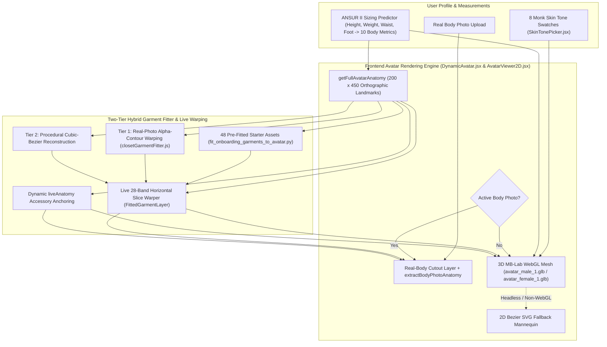

# DressApp — 3D डायनेमिक अवतार और ट्राई-ऑन पोजिशनिंग सिस्टम आर्किटेक्चर (`Avatar.md`)

> **दस्तावेज़ संस्करण:** 3.0  
> **लक्षित सबसिस्टम:** फ्रंटएंड 3D MB-Lab WebGL अवतार, रियल बॉडी फोटो कटआउट और एनाटॉमिकल गारमेंट ओवरले इंजन  
> **मुख्य फ़ाइलें:** `DynamicAvatar.jsx`, `AvatarViewer2D.jsx`, `closetGarmentFitter.js`, `SkinTonePicker.jsx`, `fit_onboarding_garments_to_avatar.py`, `onboardingDataset.js`  
> **स्थिति:** प्रोडक्शन में जारी और कैलिब्रेटेड  

---

## 1. कार्यकारी सारांश और मूल्य प्रस्ताव

### 1.1 उच्च-स्तरीय अवलोकन
**DressApp 3D डायनेमिक अवतार और ट्राई-ऑन पोजिशनिंग सिस्टम** एक अनुकूली, रीयल-टाइम विज़ुअल ट्राई-ऑन वातावरण प्रदान करता है। यह उपयोगकर्ताओं को अपनी डिजिटल अलमारी के कपड़ों और स्टार्टर कैप्सूल के परिधानों को या तो **सेगमेंटेड रियल-बॉडी फ़ोटोग्राफ़** पर या कैलिब्रेटेड `200 x 450` ऑर्थोग्राफ़िक viewBox के भीतर Three.js / React Three Fiber के माध्यम से रेंडर किए गए **यथार्थवादी 3D MB-Lab मानव मेश** (`avatar_male_1.glb` और `avatar_female_1.glb`, स्वचालित 2D बेज़ियर SVG फ़ॉलबैक के साथ) के ऊपर सहज रूप से लेयर करके प्रीव्यू करने की सुविधा देता है।

सभी परिधान श्रेणियों (टॉप्स, शर्ट, आउटरवियर, पतलून, स्कर्ट, पूरे शरीर के पारंपरिक/सांस्कृतिक परिधान, जूते और एक्सेसरीज़) में उच्च दृश्य सटीकता प्रदान करने के लिए, इंजन **सटीक 3D ऑर्थोग्राफ़िक सिल्हूट लैंडमार्क**, **दो-स्तरीय हाइब्रिड गारमेंट फिटर** और **लाइव क्षैतिज स्लाइस वार्पिंग** को जोड़ता है।

### 1.2 उपयोगकर्ता मूल्य प्रस्ताव
* **यथार्थवादी 3D MB-Lab मानव मेश**: सपाट 2D सिल्हूट को यथार्थवादी 3D पुरुष (`avatar_male_1.glb`) और महिला (`avatar_female_1.glb`) मेश से बदलता है, जो हल्के फैले हुए पैरों और हथेलियों व कूल्हों के बीच जगह छोड़ती हुई आरामदायक बांहों के साथ प्राकृतिक A-स्टांस में सीधे खड़े होते हैं।
* **डायनेमिक बॉडी मॉर्फिंग और 8 मोंक स्किन टोन**: फिजिकली बेस्ड (`MeshPhysicalMaterial`) शेडर के माध्यम से उपयोगकर्ता के माप (ऊंचाई, वजन, कंधे, छाती, कमर, कूल्हे) और 8 यथार्थवादी मानव स्किन टोन (`#F6EDE4` से `#3A2518`) पर रीयल टाइम में प्रतिक्रिया करता है।
* **3D-कैलिब्रेटेड गारमेंट और एक्सेसरी निर्देशांक**: सभी 48 स्टार्टर कैप्सूल कपड़ों और उपयोगकर्ता की अलमारी के किसी भी आइटम को सटीक 3D सिल्हूट निर्देशांकों पर मैप करता है—जिसमें फैली हुई बांहें (`wElbowOut`, `wWristOut`), धड़ की चौड़ाई, A-स्टांस पैर (`wOuterKnee`, `wOuterAnkle`) और फैले हुए पंजे (`wFootTip`, `wFootHeel`) शामिल हैं।
* **डुअल-अवतार लचीलापन**: किसी भी समय अपनी व्यक्तिगत सेगमेंटेड फुल-बॉडी फोटो और 3D डायनेमिक अवतार के बीच सहजता से स्विच करें।

---

## 2. 3D अवतार आर्किटेक्चर (`DynamicAvatar.jsx`)

### 2.1 Blender MB-Lab एसेट्स और ऑर्थोग्राफ़िक कैमरा कैलिब्रेशन
* **एसेट्स**:
  * पुरुष मेश: `apps/web/public/models/avatar_male_1.glb` (`height = 1.7877 m`, फ़्लोर ऑफ़सेट `ymin = -0.0061 m`)
  * महिला मेश: `apps/web/public/models/avatar_female_1.glb` (`height = 1.6873 m`, फ़्लोर ऑफ़सेट `ymin = -0.0061 m`)
* **ऑर्थोग्राफ़िक प्रोजेक्शन**:
  * लॉजिकल `200 x 450` viewBox (`aspect = 200 / 450`) के भीतर `<Canvas orthographic camera={{ zoom: 109, position: [0, 0, 5] }}>` के माध्यम से रेंडर किया गया।
  * `zoom = 109` पर, `1 मीटर = 109 SVG इकाइयाँ`, जो `450`-इकाई कैनवास के लंबवत केंद्र को `Y = 225` पर रखता है।
* **डिकपल्ड आनुपातिक स्केलिंग (`Realistic3DAvatarMesh`)**:
  * लंबवत स्केल (`scaleY`) सीधे `targetSvgHeight / (baseModelHeightM * 109)` से गणना किया जाता है और `yFeet` (`baseModelYMinM = -0.0061`) पर एंकर किया जाता है, जो सभी ऊंचाइयों (`140 cm` से `210 cm`) में `getFullAvatarAnatomy` के साथ 1-से-1 लंबवत संरेखण की गारंटी देता है।
  * क्षैतिज स्केल (`scaleX`, `scaleZ`) की गणना बेसलाइन एंथ्रोपोमेट्रिक माप (`scaleXZ`) के सापेक्ष `chest`, `waist`, `hip` और `shoulders` के भारित अनुपात से स्वतंत्र रूप से की जाती है, जिससे ऊंचाई बदलने पर धड़ और अंग कृत्रिम रूप से चौड़े या संकरे नहीं होते।

### 2.2 3D ऑर्थोग्राफ़िक सिल्हूट लैंडमार्क (`getFullAvatarAnatomy`)
`avatar_male_1.glb` और `avatar_female_1.glb` के त्रिभुज मेश को 1-इकाई लंबवत अंतराल पर `200 x 450` SVG निर्देशांक स्थान में रास्टराइज़ करके, `getFullAvatarAnatomy` सटीक बेसलाइन लैंडमार्क (`heightRatio` और परिधि अनुपात द्वारा गतिशील रूप से स्केल किए गए) प्रदान करता है:

| लैंडमार्क समूह | पुरुष बेसलाइन (`178 cm`) | महिला बेसलाइन (`166 cm`) | उद्देश्य |
| --- | --- | --- | --- |
| **लंबवत धड़ ज़ोन** | `yChin: 58.5`, `yShoulders: 68.0`, `yChest: 100.0`, `yWaist: 138.0`, `yHip: 175.0`, `yCrotch: 190.0` | `yChin: 77.0`, `yShoulders: 87.0`, `yChest: 118.0`, `yWaist: 147.0`, `yHip: 185.0`, `yCrotch: 199.0` | कॉलर, कंधे की सीम, छाती/बस्ट, कमरबंद, पेल्विस और इनसीम विभाजन |
| **लंबवत अंग ज़ोन** | `yElbow: 134.0`, `yWrist: 186.0`, `yKnees: 278.0`, `yAnkles: 356.0`, `yFeet: 382.0` | `yElbow: 148.0`, `yWrist: 195.0`, `yKnees: 282.0`, `yAnkles: 356.0`, `yFeet: 382.0` | शॉर्ट/3-क्वार्टर/लॉन्ग स्लीव हेम, शॉर्ट्स/मिडी/एंकल हेम और जूते का स्थान |
| **धड़ की आधी चौड़ाई** | `wNeck: 12.1`, `wShoulders: 38.6`, `wChest: 28.0`, `wWaist: 22.8`, `wHip: 25.8` | `wNeck: 10.5`, `wShoulders: 32.5`, `wChest: 24.4`, `wWaist: 19.6`, `wHip: 26.8` | नेकलाइन ओपनिंग, कंधे का ढलान, धड़ की साइड सीम और हिप ड्रेप |
| **फैली हुई बांहों की सीमाएँ** | `wElbowOut: 49.0`, `wElbowIn: 32.8`, `wWristOut: 61.0`, `wWristIn: 47.2` | `wElbowOut: 41.2`, `wElbowIn: 28.8`, `wWristOut: 53.0`, `wWristIn: 42.8` | कोणीय आस्तीन गलियारे और कलाई/घड़ी/दस्ताने के एंकर |
| **A-स्टांस पैर और पंजे की सीमाएँ** | `wOuterKnee: 33.8`, `wInnerKnee: 16.5`, `wOuterAnkle: 37.8`, `wInnerAnkle: 26.2`, `wFootTip: 42.2`, `wFootHeel: 24.0` | `wOuterKnee: 31.8`, `wInnerKnee: 16.2`, `wOuterAnkle: 36.2`, `wInnerAnkle: 26.0`, `wFootTip: 40.2`, `wFootHeel: 23.0` | पतलून के लेग ट्यूब, स्कर्ट हेम और बाएं/दाएं फुटवियर बॉक्स |

---

## 3. दो-स्तरीय हाइब्रिड गारमेंट फिटर और लाइव स्लाइस वार्पिंग

### 3.1 प्री-फिटेड ऑनबोर्डिंग स्टार्टर कैप्सूल (`scripts/fit_onboarding_garments_to_avatar.py`)
* `apps/web/src/lib/onboardingDataset.js` में `default_viewbox` और `point_cloud` मेटाडेटा के साथ `apps/web/public/assets/onboarding/` में सभी 48 पारदर्शी RGBA कटआउट ($900 \times 1500$ रिज़ॉल्यूशन पर `*_fitted.png` और `.jpg`) जनरेट करता है।
* `getFullAvatarAnatomy` के साथ संरेखित `compute_avatar_geometry` का उपयोग करता है ताकि टॉप्स/आउटरवियर 3D फैली हुई बांहों के गलियारों (`wElbowOut`/`wWristOut`) का अनुसरण करें, पतलून/जींस A-स्टांस पैर केंद्रों (`legTopCenter` → `kneeCenter` → `ankleCenter`) का अनुसरण करें, स्कर्ट A-स्टांस पिंडलियों पर खूबसूरती से फैलें, और जोड़े वाले जूते सीधे `(FootHeel..FootTip, yAnkles..yFeet)` पर बैठें।

### 3.2 रनटाइम क्लोज़ेट गारमेंट फिटर (`closetGarmentFitter.js`)
* **एनाटॉमिकल एनवलप (`getGarmentAnatomicalEnvelope`)**: किसी भी परिधान श्रेणी के लिए लक्षित बाउंडिंग बॉक्स (`default_viewbox`) और शारीरिक लैंडमार्क (`wElbowOut`, `wElbowIn`, `wWristOut`, `wWristIn`, `wOuterKnee`, `wInnerKnee`, `wOuterAnkle`, `wInnerAnkle`, `leftAnkleX`, `rightAnkleX`) की गणना करता है।
* **स्तर 1 — रियल-फोटो अल्फा-कंटूर वार्पिंग (`warpRealGarmentPhotoToDefaultCanvas`)**:
  * टॉप्स, शर्ट, ड्रेस और आउटरवियर को 3D अवतार की नेकलाइन (`yNeckBase`) और कंधे की चौड़ाई (`shoulderSpan`) पर एंकर करता है, और 3D बांह के कोण के साथ आस्तीन को साफ-सुथरे ढंग से मैप करता है।
  * एक सख्त **क्रॉच बैरियर (`yCrotchTarget >= yCrotch`)** के साथ राइज़ स्टाइल के अनुसार `yWaist` और `yHip` के बीच पैंट/स्कर्ट को पोजिशन करता है, और बाएं/दाएं पतलून के पैरों को कूल्हे से टखने तक 3D अवतार के A-स्टांस पैर केंद्रों के साथ संरेखित करता है।
  * जोड़े वाले फुटवियर कटआउट (`analyzeFootwearCutout`) को विभाजित करता है ताकि बाएं और दाएं जूते `leftAnkleX` और `rightAnkleX` (`±(wFootTip + wFootHeel) / 2`) पर मैप हों।
* **स्तर 2 — प्रोसीजरल क्यूबिक-बेज़ियर पुनर्निर्माण (`renderProceduralBezierFittedGarment`)**:
  * 3D अवतार की बांह, धड़, पैर और पंजे के निर्देशांकों से बंधे क्यूबिक-बेज़ियर पथों का उपयोग करने वाला फ़ॉलबैक सिल्हूट जनरेटर।

### 3.3 लाइव क्षैतिज स्लाइस वार्पिंग और एक्सेसरी पोजिशनिंग (`AvatarViewer2D.jsx`)
* **क्षैतिज स्लाइस वार्पिंग (`FittedGarmentLayer`)**:
  * प्रत्येक फिट किए गए कपड़े को उसके `default_viewbox` में `28` क्षैतिज स्लाइस में विभाजित करता है।
  * प्रत्येक स्लाइस के बेसलाइन लंबवत मध्यबिंदु (`y0Mid`) को उपयोगकर्ता के लाइव माप-मॉर्फ्ड लंबवत स्थान (`mapBaselineYToLiveY`) और क्षैतिज चौड़ाई अनुपात (`getLiveWidthScaleAtY`) से मैप करता है, जिससे सभी शरीर की ऊंचाइयों और चौड़ाइयों में कपड़ों को गतिशील रूप से स्ट्रेच और पोजिशन किया जाता है।
* **डायनेमिक `liveAnatomy` एक्सेसरी एंकरिंग (`renderGarment`)**:
  * **हेडवियर (टोपी/पगड़ी)**: `X = 100` पर केंद्रित, `yCrown` और `yHeadCenter` (`width = wHead * 2.55`) पर एंकर किया गया।
  * **चश्मा**: आंखों के स्तर पर स्थित (`yCrown + (yChin - yCrown) * 0.43`, `width = wHead * 1.95`)।
  * **झुमके (Earrings)**: कान की लोब से स्थित (`yChin - 12` से `yChin + 10`, `width = wHead * 2.35`)।
  * **स्कार्फ / नेकवियर और नेकलेस / टाई**: `yNeckBase` पर एंकर और `wNeck` / `wShoulders` द्वारा स्केल किया गया।
  * **बेल्ट**: `width = wWaist * 2.18` के साथ `yWaist + (yHip - yWaist) * 0.22` पर केंद्रित।
  * **घड़ी / ब्रेसलेट और दस्ताने**: फैली हुई 3D कलाई के निर्देशांकों (`yWrist`, `wWristOut`) पर एंकर किए गए।

---
*DressApp Engineering द्वारा संधारित दस्तावेज़।*
