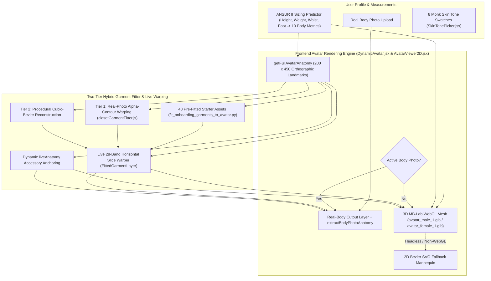

# DressApp — Architettura dell'Avatar Dinamico 3D e del Sistema di Posizionamento Prova Virtuale (`Avatar.md`)

> **Versione documento:** 3.0  
> **Sottosistema target:** Avatar Frontend 3D MB-Lab WebGL, ritagli fotografici del corpo reale e motore di sovrapposizione anatomica dei capi  
> **File principali:** `DynamicAvatar.jsx`, `AvatarViewer2D.jsx`, `closetGarmentFitter.js`, `SkinTonePicker.jsx`, `fit_onboarding_garments_to_avatar.py`, `onboardingDataset.js`  
> **Stato:** In produzione e calibrato  

---

## 1. Sintesi esecutiva e proposta di valore

### 1.1 Panoramica di alto livello
Il **Sistema di Avatar Dinamico 3D e Posizionamento Prova Virtuale di DressApp** offre un ambiente di prova visiva adattivo in tempo reale. Consente agli utenti di visualizzare in anteprima i capi digitalizzati del proprio guardaroba e gli essenziali della capsule iniziale sovrapposti con precisione su una **fotografia a figura intera segmentata** oppure su una **mesh umana 3D MB-Lab realistica** (`avatar_male_1.glb` e `avatar_female_1.glb`) renderizzata tramite Three.js / React Three Fiber all'interno di una viewBox ortografica calibrata `200 x 450` (con fallback automatico su manichino vettoriale SVG Bézier 2D).

Per garantire un'elevata precisione visiva in tutte le categorie di abbigliamento (top, camicie, capispalla, pantaloni, gonne, abiti tradizionali/culturali interi, calzature e accessori), il motore combina **riferimenti anatomici ortografici 3D esatti**, un **adattatore ibrido di capi a due livelli** e la **deformazione dinamica a fasce orizzontali (slice warping)**.

### 1.2 Proposta di valore per l'utente
* **Mesh umane 3D MB-Lab realistiche**: Sostituisce le sagome piatte 2D con mesh 3D maschili (`avatar_male_1.glb`) e femminili (`avatar_female_1.glb`) realistiche in posizione eretta naturale a A, con piedi leggermente divaricati e braccia rilassate che lasciano spazio tra i palmi e i fianchi.
* **Morphing corporeo dinamico e 8 tonalità di pelle Monk**: Risponde in tempo reale alle misure dell'utente (altezza, peso, spalle, torace, vita, fianchi) e a 8 tonalità realistiche di pelle umana (`#F6EDE4` fino a `#3A2518`) tramite uno shader fisicamente accurato (`MeshPhysicalMaterial`).
* **Coordinate di capi e accessori calibrate in 3D**: Mappa tutti i 48 capi della capsule iniziale e qualsiasi articolo del guardaroba utente sulle coordinate esatte della sagoma 3D — incluse le braccia distese (`wElbowOut`, `wWristOut`), le larghezze del busto, le gambe in posa a A (`wOuterKnee`, `wOuterAnkle`) e i piedi divaricati (`wFootTip`, `wFootHeel`).
* **Flessibilità a doppio avatar**: Passa istantaneamente in qualsiasi momento dalla tua foto personale a figura intera scontornata all'avatar dinamico 3D.

---

## 2. Architettura dell'Avatar 3D (`DynamicAvatar.jsx`)

### 2.1 Asset Blender MB-Lab e calibrazione della fotocamera ortografica
* **Asset**:
  * Mesh maschile: `apps/web/public/models/avatar_male_1.glb` (`height = 1.7877 m`, offset pavimento `ymin = -0.0061 m`)
  * Mesh femminile: `apps/web/public/models/avatar_female_1.glb` (`height = 1.6873 m`, offset pavimento `ymin = -0.0061 m`)
* **Proiezione ortografica**:
  * Renderizzata tramite `<Canvas orthographic camera={{ zoom: 109, position: [0, 0, 5] }}>` all'interno di una viewBox logica `200 x 450` (`aspect = 200 / 450`).
  * A `zoom = 109`, `1 metro = 109 unità SVG`, posizionando il centro verticale del canvas di `450` unità a `Y = 225`.
* **Scalatura proporzionale disaccoppiata (`Realistic3DAvatarMesh`)**:
  * La scala verticale (`scaleY`) è calcolata direttamente da `targetSvgHeight / (baseModelHeightM * 109)` e ancorata a `yFeet` (`baseModelYMinM = -0.0061`), garantendo un allineamento verticale 1:1 con `getFullAvatarAnatomy` per tutte le altezze (`140 cm` – `210 cm`).
  * La scala orizzontale (`scaleX`, `scaleZ`) è calcolata in modo indipendente dai rapporti ponderati di `chest`, `waist`, `hip` e `shoulders` rispetto alle misure antropometriche di base (`scaleXZ`), evitando che le variazioni di altezza allarghino o stringano artificialmente il busto e gli arti.

### 2.2 Riferimenti anatomici ortografici 3D (`getFullAvatarAnatomy`)
Rasterizzando le mesh triangolari di `avatar_male_1.glb` e `avatar_female_1.glb` nello spazio di coordinate SVG `200 x 450` a intervalli verticali di 1 unità, `getFullAvatarAnatomy` espone riferimenti di base esatti (scalati dinamicamente tramite `heightRatio` e rapporti di circonferenza):

| Gruppo di riferimenti | Base Uomo (`178 cm`) | Base Donna (`166 cm`) | Scopo |
| --- | --- | --- | --- |
| **Zone verticali del busto** | `yChin: 58.5`, `yShoulders: 68.0`, `yChest: 100.0`, `yWaist: 138.0`, `yHip: 175.0`, `yCrotch: 190.0` | `yChin: 77.0`, `yShoulders: 87.0`, `yChest: 118.0`, `yWaist: 147.0`, `yHip: 185.0`, `yCrotch: 199.0` | Colletto, cucitura spalle, petto/seno, girovita, bacino e biforcazione del cavallo |
| **Zone verticali degli arti** | `yElbow: 134.0`, `yWrist: 186.0`, `yKnees: 278.0`, `yAnkles: 356.0`, `yFeet: 382.0` | `yElbow: 148.0`, `yWrist: 195.0`, `yKnees: 282.0`, `yAnkles: 356.0`, `yFeet: 382.0` | Orli maniche corte/tre quarti/lunghe, orli pantaloncini/midi/caviglia e posizionamento scarpe |
| **Semilarghezze del busto** | `wNeck: 12.1`, `wShoulders: 38.6`, `wChest: 28.0`, `wWaist: 22.8`, `wHip: 25.8` | `wNeck: 10.5`, `wShoulders: 32.5`, `wChest: 24.4`, `wWaist: 19.6`, `wHip: 26.8` | Apertura scollo, inclinazione spalle, cuciture laterali del busto e caduta sui fianchi |
| **Limiti braccia distese** | `wElbowOut: 49.0`, `wElbowIn: 32.8`, `wWristOut: 61.0`, `wWristIn: 47.2` | `wElbowOut: 41.2`, `wElbowIn: 28.8`, `wWristOut: 53.0`, `wWristIn: 42.8` | Corridoi maniche angolate e ancoraggi polso/orologio/guanti |
| **Limiti gambe a A e piedi** | `wOuterKnee: 33.8`, `wInnerKnee: 16.5`, `wOuterAnkle: 37.8`, `wInnerAnkle: 26.2`, `wFootTip: 42.2`, `wFootHeel: 24.0` | `wOuterKnee: 31.8`, `wInnerKnee: 16.2`, `wOuterAnkle: 36.2`, `wInnerAnkle: 26.0`, `wFootTip: 40.2`, `wFootHeel: 23.0` | Gambali dei pantaloni, orli delle gonne e riquadri scarpa sinistra/destra |

---

## 3. Adattatore ibrido a due livelli e deformazione a fasce in tempo reale

### 3.1 Capsule iniziale di onboarding pre-adattata (`scripts/fit_onboarding_garments_to_avatar.py`)
* Genera tutti i 48 ritagli RGBA trasparenti (`*_fitted.png` e `.jpg` a risoluzione $900 \times 1500$) in `apps/web/public/assets/onboarding/` insieme ai metadati `default_viewbox` e `point_cloud` in `apps/web/src/lib/onboardingDataset.js`.
* Utilizza `compute_avatar_geometry` allineato con `getFullAvatarAnatomy` in modo che top e capispalla seguano i corridoi delle braccia 3D (`wElbowOut`/`wWristOut`), pantaloni e jeans seguano i centri gamba in posa a A (`legTopCenter` → `kneeCenter` → `ankleCenter`), le gonne scendano morbide sui polpacci e le scarpe in paio si posizionino esattamente su `(FootHeel..FootTip, yAnkles..yFeet)`.

### 3.2 Adattatore runtime per i capi del guardaroba (`closetGarmentFitter.js`)
* **Inviluppo anatomico (`getGarmentAnatomicalEnvelope`)**: Calcola il riquadro di delimitazione target (`default_viewbox`) e i riferimenti anatomici (`wElbowOut`, `wElbowIn`, `wWristOut`, `wWristIn`, `wOuterKnee`, `wInnerKnee`, `wOuterAnkle`, `wInnerAnkle`, `leftAnkleX`, `rightAnkleX`) per qualsiasi categoria di capo.
* **Livello 1 — Deformazione del contorno alfa da foto reale (`warpRealGarmentPhotoToDefaultCanvas`)**:
  * Ancora top, camicie, abiti e capispalla alla base del collo (`yNeckBase`) e alla larghezza delle spalle (`shoulderSpan`) dell'avatar 3D, mappando con precisione le maniche lungo l'angolo delle braccia 3D.
  * Posiziona pantaloni e gonne tra `yWaist` e `yHip` in base all'altezza della vita con una rigorosa **barriera del cavallo (`yCrotchTarget >= yCrotch`)**, e trasla i gambali sinistro e destro lungo i centri gamba in posa a A dal fianco alla caviglia.
  * Divide i ritagli delle calzature in paio (`analyzeFootwearCutout`) in modo che la scarpa sinistra e destra siano mappate su `leftAnkleX` e `rightAnkleX` (`±(wFootTip + wFootHeel) / 2`).
* **Livello 2 — Ricostruzione procedurale Bézier cubica (`renderProceduralBezierFittedGarment`)**:
  * Generatore di sagome di fallback che utilizza tracciati Bézier cubici vincolati alle coordinate di braccia, busto, gambe e piedi dell'avatar 3D.

### 3.3 Deformazione dinamica a fasce orizzontali e posizionamento accessori (`AvatarViewer2D.jsx`)
* **Deformazione a fasce orizzontali (`FittedGarmentLayer`)**:
  * Suddivide ogni capo adattato in `28` fasce orizzontali lungo la sua `default_viewbox`.
  * Mappa il punto medio verticale di base di ciascuna fascia (`y0Mid`) alla posizione verticale live modellata sulle misure dell'utente (`mapBaselineYToLiveY`) e al rapporto di larghezza orizzontale (`getLiveWidthScaleAtY`), adattando e posizionando dinamicamente i capi per qualsiasi altezza e corporatura.
* **Ancoraggio dinamico degli accessori tramite `liveAnatomy` (`renderGarment`)**:
  * **Copricapo**: Centrato su `X = 100`, ancorato a `yCrown` e `yHeadCenter` (`width = wHead * 2.55`).
  * **Occhiali**: Posizionati al livello degli occhi (`yCrown + (yChin - yCrown) * 0.43`, `width = wHead * 1.95`).
  * **Orecchini**: Posizionati dal lobo dell'orecchio (`yChin - 12` a `yChin + 10`, `width = wHead * 2.35`).
  * **Sciarpa / Foulard, Collana e Cravatta**: Ancorati a `yNeckBase` e scalati in base a `wNeck` / `wShoulders`.
  * **Cintura**: Centrata a `yWaist + (yHip - yWaist) * 0.22` con `width = wWaist * 2.18`.
  * **Orologio / Bracciale e Guanti**: Ancorati alle coordinate 3D dei polsi distesi (`yWrist`, `wWristOut`).

---
*Documento mantenuto da DressApp Engineering.*
