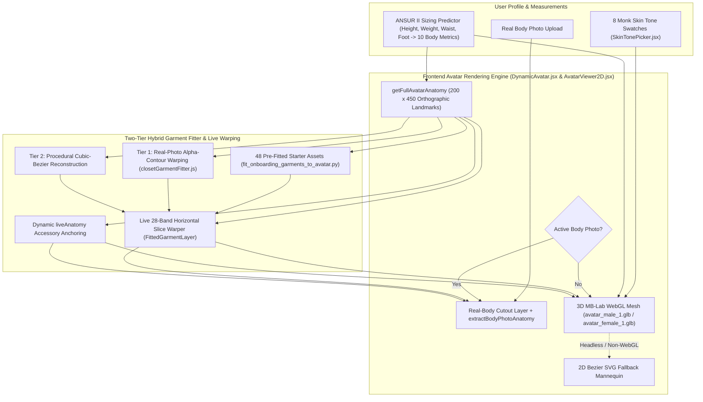

# DressApp — 3Dダイナミックアバター＆バーチャル試着ポジショニングシステムアーキテクチャ (`Avatar.md`)

> **ドキュメントバージョン:** 3.0  
> **対象サブシステム:** フロントエンド 3D MB-Lab WebGLアバター、実写全身写真切り抜き＆解剖学的衣類オーバーレイエンジン  
> **主要ファイル:** `DynamicAvatar.jsx`, `AvatarViewer2D.jsx`, `closetGarmentFitter.js`, `SkinTonePicker.jsx`, `fit_onboarding_garments_to_avatar.py`, `onboardingDataset.js`  
> **ステータス:** 本番環境リリース・キャリブレーション済み  

---

## 1. エグゼクティブサマリーと価値提案

### 1.1 ハイレベル概要
**DressApp 3Dダイナミックアバター＆バーチャル試着ポジショニングシステム**は、リアルタイムで適応するビジュアル試着環境を提供します。ユーザーは、デジタル化したクローゼットの衣類やスターターカプセルの定番アイテムを、**セグメント化された実写の全身写真**、またはキャリブレーション済みの`200 x 450`平行投影（orthographic）viewBox内でThree.js / React Three Fiberによって描画される**リアルな3D MB-Labヒューマンメッシュ**（`avatar_male_1.glb`および`avatar_female_1.glb`、自動2DベジェSVGフォールバック付き）の上にシームレスに重ねてプレビューできます。

あらゆる衣類カテゴリ（トップス、シャツ、アウター、パンツ、スカート、全身の伝統・民族衣装、靴、アクセサリー）で高い視覚的精度を実現するため、本エンジンは**正確な3D平行投影シルエットランドマーク**、**2段階ハイブリッド衣類フィッター**、および**リアルタイム水平スライスワーピング**を組み合わせています。

### 1.2 ユーザーへの価値提案
* **リアルな3D MB-Labヒューマンメッシュ**: 平面的な2Dシルエットを、足をわずかに広げ、手のひらと腰の間に自然な空間を保って腕を下ろしたAスタンスで真っ直ぐ立つリアルな3D男性（`avatar_male_1.glb`）および女性（`avatar_female_1.glb`）メッシュに置き換えます。
* **ダイナミックな体型モーフィング＆8種類のMonkスキントーン**: 物理ベースシェーダー（`MeshPhysicalMaterial`）を介して、ユーザーのサイズ測定値（身長、体重、肩幅、胸囲、ウエスト、ヒップ）と8種類のリアルな肌色（`#F6EDE4`〜`#3A2518`）にリアルタイムで反応します。
* **3Dキャリブレーション済みの衣類＆アクセサリー座標**: 48点のスターターカプセル衣類と任意のユーザークローゼットアイテムを、広げた腕（`wElbowOut`, `wWristOut`）、胴体幅、Aスタンスの脚（`wOuterKnee`, `wOuterAnkle`）、広げた足元（`wFootTip`, `wFootHeel`）を含む正確な3Dシルエット座標にマッピングします。
* **デュアルアバターの柔軟性**: セグメント化された個人の全身写真と3Dダイナミックアバターをいつでもシームレスに切り替えられます。

---

## 2. 3Dアバターアーキテクチャ (`DynamicAvatar.jsx`)

### 2.1 Blender MB-Labアセットと平行投影カメラキャリブレーション
* **アセット**:
  * 男性メッシュ: `apps/web/public/models/avatar_male_1.glb`（`height = 1.7877 m`、床面オフセット `ymin = -0.0061 m`）
  * 女性メッシュ: `apps/web/public/models/avatar_female_1.glb`（`height = 1.6873 m`、床面オフセット `ymin = -0.0061 m`）
* **平行投影（Orthographic Projection）**:
  * 論理viewBox `200 x 450`（`aspect = 200 / 450`）内で `<Canvas orthographic camera={{ zoom: 109, position: [0, 0, 5] }}>` により描画されます。
  * `zoom = 109`において`1メートル = 109 SVGユニット`となり、`450`ユニットキャンバスの垂直中心が`Y = 225`に配置されます。
* **分離型比例スケーリング (`Realistic3DAvatarMesh`)**:
  * 垂直スケール（`scaleY`）は `targetSvgHeight / (baseModelHeightM * 109)` から直接計算され、`yFeet`（`baseModelYMinM = -0.0061`）に固定されるため、あらゆる身長（`140 cm`〜`210 cm`）で `getFullAvatarAnatomy` との1対1の垂直アライメントが保証されます。
  * 水平スケール（`scaleX`, `scaleZ`）は、基準人体測定値に対する `chest`、`waist`、`hip`、`shoulders` の加重比率（`scaleXZ`）から独立して計算され、身長の変更によって胴体や四肢が不自然に太くなったり細くなったりするのを防ぎます。

### 2.2 3D平行投影シルエットランドマーク (`getFullAvatarAnatomy`)
`avatar_male_1.glb` と `avatar_female_1.glb` の三角形メッシュを1ユニットの垂直間隔で `200 x 450` のSVG座標空間にラスタライズすることで、`getFullAvatarAnatomy` は正確な基準ランドマーク（`heightRatio` と周囲長比率によって動的にスケール）を公開します：

| ランドマークグループ | 男性基準値 (`178 cm`) | 女性基準値 (`166 cm`) | 用途 |
| --- | --- | --- | --- |
| **垂直胴体ゾーン** | `yChin: 58.5`, `yShoulders: 68.0`, `yChest: 100.0`, `yWaist: 138.0`, `yHip: 175.0`, `yCrotch: 190.0` | `yChin: 77.0`, `yShoulders: 87.0`, `yChest: 118.0`, `yWaist: 147.0`, `yHip: 185.0`, `yCrotch: 199.0` | 襟、肩の縫い目、胸囲/バスト、ウエストバンド、骨盤、股下の分岐 |
| **垂直四肢ゾーン** | `yElbow: 134.0`, `yWrist: 186.0`, `yKnees: 278.0`, `yAnkles: 356.0`, `yFeet: 382.0` | `yElbow: 148.0`, `yWrist: 195.0`, `yKnees: 282.0`, `yAnkles: 356.0`, `yFeet: 382.0` | 半袖/七分袖/長袖の裾、ショート/ミディ/アンクル丈の裾、靴の配置 |
| **胴体半幅** | `wNeck: 12.1`, `wShoulders: 38.6`, `wChest: 28.0`, `wWaist: 22.8`, `wHip: 25.8` | `wNeck: 10.5`, `wShoulders: 32.5`, `wChest: 24.4`, `wWaist: 19.6`, `wHip: 26.8` | ネックライン開口部、肩の傾斜、胴体サイドシーム、ヒップのドレープ |
| **広げた腕の境界** | `wElbowOut: 49.0`, `wElbowIn: 32.8`, `wWristOut: 61.0`, `wWristIn: 47.2` | `wElbowOut: 41.2`, `wElbowIn: 28.8`, `wWristOut: 53.0`, `wWristIn: 42.8` | 角度のついた袖のコリドーおよび手首/腕時計/手袋のアンカー |
| **Aスタンスの脚＆足の境界** | `wOuterKnee: 33.8`, `wInnerKnee: 16.5`, `wOuterAnkle: 37.8`, `wInnerAnkle: 26.2`, `wFootTip: 42.2`, `wFootHeel: 24.0` | `wOuterKnee: 31.8`, `wInnerKnee: 16.2`, `wOuterAnkle: 36.2`, `wInnerAnkle: 26.0`, `wFootTip: 40.2`, `wFootHeel: 23.0` | パンツの脚筒、スカートの裾、左右のフットウェアボックス |

---

## 3. 2段階ハイブリッド衣類フィッター＆リアルタイムスライスワーピング

### 3.1 事前フィット済みオンボーディングスターターカプセル (`scripts/fit_onboarding_garments_to_avatar.py`)
* `apps/web/public/assets/onboarding/` 内の全48点の透明RGBA切り抜き画像（解像度 $900 \times 1500$ の `*_fitted.png` および `.jpg`）と、`apps/web/src/lib/onboardingDataset.js` 内の `default_viewbox` および `point_cloud` メタデータを生成します。
* `getFullAvatarAnatomy` に準拠した `compute_avatar_geometry` を使用し、トップス/アウターが3Dの広げた腕のコリドー（`wElbowOut`/`wWristOut`）に沿い、パンツ/ジーンズがAスタンスの脚の中心線（`legTopCenter` → `kneeCenter` → `ankleCenter`）に沿い、スカートがAスタンスのふくらはぎの上に自然に広がり、ペアの靴が `(FootHeel..FootTip, yAnkles..yFeet)` の上に正確に配置されるようにします。

### 3.2 ランタイムクローゼット衣類フィッター (`closetGarmentFitter.js`)
* **解剖学的エンベロープ (`getGarmentAnatomicalEnvelope`)**: すべての衣類カテゴリに対して、ターゲットバウンディングボックス（`default_viewbox`）と解剖学的ランドマーク（`wElbowOut`, `wElbowIn`, `wWristOut`, `wWristIn`, `wOuterKnee`, `wInnerKnee`, `wOuterAnkle`, `wInnerAnkle`, `leftAnkleX`, `rightAnkleX`）を計算します。
* **ティア1 — 実写アルファ輪郭ワーピング (`warpRealGarmentPhotoToDefaultCanvas`)**:
  * トップス、シャツ、ドレス、アウターを3Dアバターの首の付け根（`yNeckBase`）と肩幅（`shoulderSpan`）に固定し、3Dの腕の角度に沿って袖を綺麗にマッピングします。
  * 厳格な**股下バリア（`yCrotchTarget >= yCrotch`）**を適用しつつ股上のスタイルに応じてパンツ/スカートを `yWaist` と `yHip` の間に配置し、左右のパンツの脚をヒップから足首まで3DアバターのAスタンスの脚中心線に沿って変換します。
  * ペアの靴の切り抜き画像（`analyzeFootwearCutout`）を分割し、左右の靴を `leftAnkleX` と `rightAnkleX`（`±(wFootTip + wFootHeel) / 2`）にマッピングします。
* **ティア2 — プロシージャル3次ベジェ再構築 (`renderProceduralBezierFittedGarment`)**:
  * 3Dアバターの腕、胴体、脚、足の座標にバインドされた3次ベジェパスを使用するフォールバックシルエットジェネレーターです。

### 3.3 リアルタイム水平スライスワーピング＆アクセサリー配置 (`AvatarViewer2D.jsx`)
* **水平スライスワーピング (`FittedGarmentLayer`)**:
  * フィット済みの各衣類を `default_viewbox` 全体にわたって`28`個の水平スライスに分割します。
  * 各スライスの基準垂直中点（`y0Mid`）をユーザーのリアルタイム測定モーフィング垂直位置（`mapBaselineYToLiveY`）と水平幅比率（`getLiveWidthScaleAtY`）にマッピングし、あらゆる身長・体型幅に合わせて衣類を動的に伸縮・配置します。
* **ダイナミックな `liveAnatomy` アクセサリー固定 (`renderGarment`)**:
  * **帽子・ヘッドウェア**: `X = 100` を中心とし、`yCrown` と `yHeadCenter` に固定（`width = wHead * 2.55`）。
  * **メガネ・サングラス**: 目の高さに配置（`yCrown + (yChin - yCrown) * 0.43`、`width = wHead * 1.95`）。
  * **イヤリング・ピアス**: 耳たぶの位置に配置（`yChin - 12` 〜 `yChin + 10`、`width = wHead * 2.35`）。
  * **スカーフ / ネックウェア＆ネックレス / ネクタイ**: `yNeckBase` に固定し、`wNeck` / `wShoulders` でスケーリング。
  * **ベルト**: `yWaist + (yHip - yWaist) * 0.22` を中心に配置（`width = wWaist * 2.18`）。
  * **腕時計 / ブレスレット＆手袋**: 広げた3D手首座標（`yWrist`, `wWristOut`）に固定。

---
*本ドキュメントは DressApp Engineering により管理されています。*
