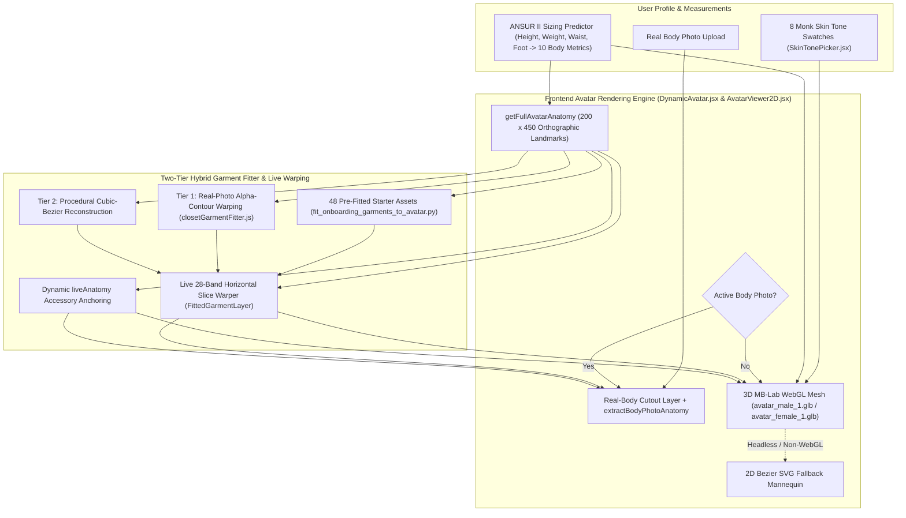

# DressApp — Architectuur van de Dynamische 3D-Avatar & het Virtuele Pas-Positioneringssysteem (`Avatar.md`)

> **Documentversie:** 3.0  
> **Doelsubsysteem:** Frontend 3D MB-Lab WebGL-avatar, uitknipsels van echte lichaamsfoto's & anatomische kleding-overlay-engine  
> **Kernbestanden:** `DynamicAvatar.jsx`, `AvatarViewer2D.jsx`, `closetGarmentFitter.js`, `SkinTonePicker.jsx`, `fit_onboarding_garments_to_avatar.py`, `onboardingDataset.js`  
> **Status:** In productie & gekalibreerd  

---

## 1. Managementsamenvatting & Waardepropositie

### 1.1 Overzicht op hoog niveau
Het **Dynamische 3D-Avatar & Virtuele Pas-Positioneringssysteem van DressApp** biedt een adaptieve, realtime visuele pasomgeving. Het stelt gebruikers in staat om gedigitaliseerde kledingstukken uit hun eigen kast en basisstukken uit de starterscapsule naadloos gelaagd te bekijken bovenop ofwel een **gesegmenteerde echte lichaamsfoto** ofwel een **realistische menselijke 3D MB-Lab-mesh** (`avatar_male_1.glb` en `avatar_female_1.glb`), gerenderd via Three.js / React Three Fiber binnen een gekalibreerde orthografische `200 x 450`-viewBox (met automatische 2D Bézier SVG-terugvaloptie).

Om een hoge visuele nauwkeurigheid te leveren in alle kledingcategorieën (tops, overhemden, bovenkleding, broeken, rokken, traditionele/culturele kleding uit één stuk, schoenen en accessoires), combineert de engine **exacte orthografische 3D-silhouetpunten**, een **tweetraps hybride kledingfitter** en **live horizontale slice-warping**.

### 1.2 Waardepropositie voor de gebruiker
* **Realistische menselijke 3D MB-Lab-meshes**: Vervangt platte 2D-silhouetten door realistische mannelijke (`avatar_male_1.glb`) en vrouwelijke (`avatar_female_1.glb`) 3D-meshes die rechtop staan in een natuurlijke A-stand met licht gespreide voeten en ontspannen armen die ruimte laten tussen de handpalmen en de heupen.
* **Dynamische lichaamsmorphing & 8 Monk-huidskleuren**: Reageert in realtime op de maten van de gebruiker (lengte, gewicht, schouders, borst, taille, heupen) en 8 realistische menselijke huidskleuren (`#F6EDE4` t/m `#3A2518`) via een fysiek gebaseerde shader (`MeshPhysicalMaterial`).
* **3D-gekalibreerde kleding- & accessoirecoördinaten**: Plaatst alle 48 kledingstukken uit de starterscapsule en willekeurige kledingkastitems van de gebruiker op de exacte 3D-silhouetcoördinaten — inclusief licht gespreide armen (`wElbowOut`, `wWristOut`), rompbreedtes, A-stand-benen (`wOuterKnee`, `wOuterAnkle`) en gespreide voeten (`wFootTip`, `wFootHeel`).
* **Flexibiliteit met dubbele avatar**: Schakel op elk gewenst moment naadloos tussen een persoonlijke gesegmenteerde lichaamsfoto en de dynamische 3D-avatar.

---

## 2. 3D-Avatar-architectuur (`DynamicAvatar.jsx`)

### 2.1 Blender MB-Lab-assets & orthografische camerakalibratie
* **Assets**:
  * Mannelijke mesh: `apps/web/public/models/avatar_male_1.glb` (`height = 1.7877 m`, vloer-offset `ymin = -0.0061 m`)
  * Vrouwelijke mesh: `apps/web/public/models/avatar_female_1.glb` (`height = 1.6873 m`, vloer-offset `ymin = -0.0061 m`)
* **Orthografische projectie**:
  * Gerenderd via `<Canvas orthographic camera={{ zoom: 109, position: [0, 0, 5] }}>` binnen een logische `200 x 450`-viewBox (`aspect = 200 / 450`).
  * Bij `zoom = 109` geldt `1 meter = 109 SVG-eenheden`, waardoor het verticale midden van het `450`-eenheden tellende canvas op `Y = 225` ligt.
* **Losgekoppelde proportionele schaling (`Realistic3DAvatarMesh`)**:
  * De verticale schaal (`scaleY`) wordt rechtstreeks berekend uit `targetSvgHeight / (baseModelHeightM * 109)` en verankerd op `yFeet` (`baseModelYMinM = -0.0061`), wat een 1-op-1 verticale uitlijning met `getFullAvatarAnatomy` garandeert voor alle lichaamslengtes (`140 cm` tot `210 cm`).
  * De horizontale schaal (`scaleX`, `scaleZ`) wordt onafhankelijk berekend uit de gewogen verhoudingen van `chest`, `waist`, `hip` en `shoulders` ten opzichte van antropometrische basismetingen (`scaleXZ`), zodat lengteveranderingen de romp en ledematen niet kunstmatig breder of smaller maken.

### 2.2 Orthografische 3D-silhouetpunten (`getFullAvatarAnatomy`)
Door de driehoeksmeshes van `avatar_male_1.glb` en `avatar_female_1.glb` met verticale intervallen van 1 eenheid te rasteren naar de `200 x 450` SVG-coördinatenruimte, stelt `getFullAvatarAnatomy` exacte basispunten beschikbaar (dynamisch geschaald via `heightRatio` en omtrekverhoudingen):

| Groep herkenningspunten | Basis Man (`178 cm`) | Basis Vrouw (`166 cm`) | Doel |
| --- | --- | --- | --- |
| **Verticale rompzones** | `yChin: 58.5`, `yShoulders: 68.0`, `yChest: 100.0`, `yWaist: 138.0`, `yHip: 175.0`, `yCrotch: 190.0` | `yChin: 77.0`, `yShoulders: 87.0`, `yChest: 118.0`, `yWaist: 147.0`, `yHip: 185.0`, `yCrotch: 199.0` | Kraag, schoudernaad, borst/buste, tailleband, bekken en kruissplitsing |
| **Verticale ledemaatzones** | `yElbow: 134.0`, `yWrist: 186.0`, `yKnees: 278.0`, `yAnkles: 356.0`, `yFeet: 382.0` | `yElbow: 148.0`, `yWrist: 195.0`, `yKnees: 282.0`, `yAnkles: 356.0`, `yFeet: 382.0` | Zomen van korte/driekwart/lange mouwen, shorts/midi/enkelzomen en schoenplaatsing |
| **Halve rompbreedtes** | `wNeck: 12.1`, `wShoulders: 38.6`, `wChest: 28.0`, `wWaist: 22.8`, `wHip: 25.8` | `wNeck: 10.5`, `wShoulders: 32.5`, `wChest: 24.4`, `wWaist: 19.6`, `wHip: 26.8` | Halslijnopening, schouderhelling, zijnaden van de romp en heupval |
| **Grenzen gespreide armen** | `wElbowOut: 49.0`, `wElbowIn: 32.8`, `wWristOut: 61.0`, `wWristIn: 47.2` | `wElbowOut: 41.2`, `wElbowIn: 28.8`, `wWristOut: 53.0`, `wWristIn: 42.8` | Schuine mouwcorridors en pols-/horloge-/handschoenankers |
| **Grenzen A-stand-benen & voeten** | `wOuterKnee: 33.8`, `wInnerKnee: 16.5`, `wOuterAnkle: 37.8`, `wInnerAnkle: 26.2`, `wFootTip: 42.2`, `wFootHeel: 24.0` | `wOuterKnee: 31.8`, `wInnerKnee: 16.2`, `wOuterAnkle: 36.2`, `wInnerAnkle: 26.0`, `wFootTip: 40.2`, `wFootHeel: 23.0` | Broekspijpen, rokzomen en linker/rechter schoenenvakken |

---

## 3. Tweetraps hybride kledingfitter & live slice-warping

### 3.1 Vooraf gepaste onboarding-starterscapsule (`scripts/fit_onboarding_garments_to_avatar.py`)
* Genereert alle 48 transparante RGBA-uitknipsels (`*_fitted.png` en `.jpg` op $900 \times 1500$ resolutie) in `apps/web/public/assets/onboarding/` samen met `default_viewbox`- en `point_cloud`-metadata in `apps/web/src/lib/onboardingDataset.js`.
* Gebruikt `compute_avatar_geometry` afgestemd op `getFullAvatarAnatomy`, zodat tops/bovenkleding de 3D-armcorridors (`wElbowOut`/`wWristOut`) volgen, broeken/jeans de middellijnen van de A-stand-benen (`legTopCenter` → `kneeCenter` → `ankleCenter`) volgen, rokken soepel over de kuiten vallen en gepaarde schoenen rechtstreeks op `(FootHeel..FootTip, yAnkles..yFeet)` staan.

### 3.2 Runtime kledingkast-fitter (`closetGarmentFitter.js`)
* **Anatomische omhulling (`getGarmentAnatomicalEnvelope`)**: Berekent het doel-omsluitingskader (`default_viewbox`) en de anatomische herkenningspunten (`wElbowOut`, `wElbowIn`, `wWristOut`, `wWristIn`, `wOuterKnee`, `wInnerKnee`, `wOuterAnkle`, `wInnerAnkle`, `leftAnkleX`, `rightAnkleX`) voor elke kledingcategorie.
* **Niveau 1 — Alfa-contour-warping van echte foto's (`warpRealGarmentPhotoToDefaultCanvas`)**:
  * Verankert tops, overhemden, jurken en bovenkleding aan de halsbasis (`yNeckBase`) en schouderbreedte (`shoulderSpan`) van de 3D-avatar, waarbij mouwen netjes langs de 3D-armhoek worden geplaatst.
  * Positioneert broeken/rokken tussen `yWaist` en `yHip` op basis van de taillehoogte met een strikte **kruisbarrière (`yCrotchTarget >= yCrotch`)**, en verplaatst de linker- en rechterbroekspijp langs de middellijnen van de A-stand-benen van heup tot enkel.
  * Splitst uitknipsels van gepaard schoeisel (`analyzeFootwearCutout`) zodat de linker- en rechterschoen op `leftAnkleX` en `rightAnkleX` (`±(wFootTip + wFootHeel) / 2`) worden afgebeeld.
* **Niveau 2 — Procedurele kubische Bézier-reconstructie (`renderProceduralBezierFittedGarment`)**:
  * Fallback-silhouetgenerator met kubische Bézier-paden gekoppeld aan de arm-, romp-, been- en voetcoördinaten van de 3D-avatar.

### 3.3 Live horizontale slice-warping & accessoirepositionering (`AvatarViewer2D.jsx`)
* **Horizontale slice-warping (`FittedGarmentLayer`)**:
  * Verdeelt elk gepast kledingstuk over zijn `default_viewbox` in `28` horizontale stroken (slices).
  * Koppelt het verticale basismiddelpunt van elke strook (`y0Mid`) aan de live op maat aangepaste verticale positie (`mapBaselineYToLiveY`) en horizontale breedteverhouding (`getLiveWidthScaleAtY`) van de gebruiker, waardoor kledingstukken dynamisch meerekken en positioneren voor alle lichaamslengtes en -breedtes.
* **Dynamische `liveAnatomy` accessoire-verankering (`renderGarment`)**:
  * **Hoofddeksels**: Gecentreerd op `X = 100`, verankerd aan `yCrown` en `yHeadCenter` (`width = wHead * 2.55`).
  * **Brillen**: Gepositioneerd op ooghoogte (`yCrown + (yChin - yCrown) * 0.43`, `width = wHead * 1.95`).
  * **Oorbellen**: Gepositioneerd vanaf de oorlel (`yChin - 12` tot `yChin + 10`, `width = wHead * 2.35`).
  * **Sjaal / Halskleding & Ketting / Stropdas**: Verankerd op `yNeckBase` en geschaald via `wNeck` / `wShoulders`.
  * **Riem**: Gecentreerd op `yWaist + (yHip - yWaist) * 0.22` met `width = wWaist * 2.18`.
  * **Horloge / Armband & Handschoenen**: Verankerd aan de 3D-polscoördinaten (`yWrist`, `wWristOut`).

---
*Document beheerd door DressApp Engineering.*
