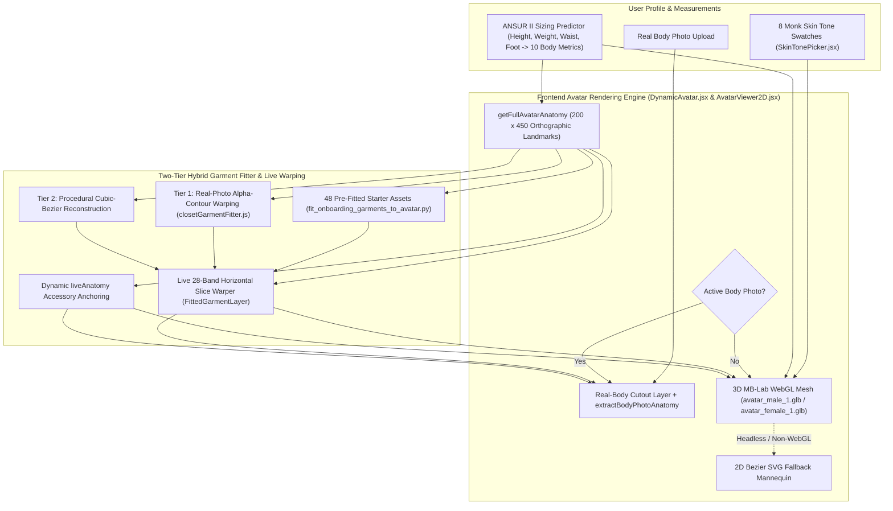

# DressApp — Arquitetura do Avatar Dinâmico 3D e Sistema de Posicionamento de Prova Virtual (`Avatar.md`)

> **Versão do Documento:** 3.0  
> **Subsistema Alvo:** Avatar Frontend 3D MB-Lab WebGL, recortes de fotos de corpo real e motor de sobreposição anatómica de peças  
> **Ficheiros Principais:** `DynamicAvatar.jsx`, `AvatarViewer2D.jsx`, `closetGarmentFitter.js`, `SkinTonePicker.jsx`, `fit_onboarding_garments_to_avatar.py`, `onboardingDataset.js`  
> **Estado:** Em produção e calibrado  

---

## 1. Resumo Executivo e Proposta de Valor

### 1.1 Visão Geral de Alto Nível
O **Sistema de Avatar Dinâmico 3D e Posicionamento de Prova Virtual do DressApp** fornece um ambiente visual de prova adaptativo em tempo real. Permite aos utilizadores pré-visualizar peças digitalizadas do seu guarda-roupa e essenciais da cápsula inicial sobrepostos de forma fluida sobre uma **fotografia segmentada de corpo real** ou sobre uma **malha humana 3D MB-Lab realista** (`avatar_male_1.glb` e `avatar_female_1.glb`) renderizada via Three.js / React Three Fiber dentro de uma viewBox ortográfica calibrada de `200 x 450` (com alternativa automática em manequim vetorial SVG Bézier 2D).

Para oferecer elevada precisão visual em todas as categorias de vestuário (partes de cima, camisas, agasalhos, calças, saias, trajes tradicionais/culturais de corpo inteiro, calçado e acessórios), o motor combina **pontos anatómicos ortográficos 3D exatos**, um **ajustador híbrido de peças de dois níveis** e **deformação de faixas horizontais em tempo real (slice warping)**.

### 1.2 Proposta de Valor para o Utilizador
* **Malhas Humanas 3D MB-Lab Realistas**: Substitui silhuetas planas 2D por malhas 3D masculinas (`avatar_male_1.glb`) e femininas (`avatar_female_1.glb`) realistas em pé numa postura natural em A, com os pés ligeiramente afastados e os braços descontraídos deixando espaço entre as palmas das mãos e as ancas.
* **Morfologia Corporal Dinâmica e 8 Tons de Pele Monk**: Responde em tempo real às medidas do utilizador (altura, peso, ombros, peito, cintura, anca) e a 8 tons de pele humana realistas (`#F6EDE4` a `#3A2518`) através de um shader baseado na física (`MeshPhysicalMaterial`).
* **Coordenadas de Peças e Acessórios Calibradas em 3D**: Mapeia todas as 48 peças da cápsula inicial e quaisquer artigos do guarda-roupa do utilizador sobre as coordenadas exatas da silhueta 3D — incluindo braços abertos (`wElbowOut`, `wWristOut`), larguras do tronco, pernas em postura em A (`wOuterKnee`, `wOuterAnkle`) e pés afastados (`wFootTip`, `wFootHeel`).
* **Flexibilidade de Duplo Avatar**: Alterne facilmente entre uma foto pessoal de corpo inteiro recortada e o avatar dinâmico 3D a qualquer momento.

---

## 2. Arquitetura do Avatar 3D (`DynamicAvatar.jsx`)

### 2.1 Ativos Blender MB-Lab e Calibração da Câmara Ortográfica
* **Ativos**:
  * Malha masculina: `apps/web/public/models/avatar_male_1.glb` (`height = 1.7877 m`, compensação do chão `ymin = -0.0061 m`)
  * Malha feminina: `apps/web/public/models/avatar_female_1.glb` (`height = 1.6873 m`, compensação do chão `ymin = -0.0061 m`)
* **Projeção Ortográfica**:
  * Renderizada via `<Canvas orthographic camera={{ zoom: 109, position: [0, 0, 5] }}>` dentro de uma viewBox lógica `200 x 450` (`aspect = 200 / 450`).
  * Com `zoom = 109`, `1 metro = 109 unidades SVG`, colocando o centro vertical da tela de `450` unidades em `Y = 225`.
* **Escala Proporcional Desacoplada (`Realistic3DAvatarMesh`)**:
  * A escala vertical (`scaleY`) é calculada diretamente a partir de `targetSvgHeight / (baseModelHeightM * 109)` e ancorada em `yFeet` (`baseModelYMinM = -0.0061`), garantindo um alinhamento vertical 1:1 com `getFullAvatarAnatomy` em todas as alturas (`140 cm` a `210 cm`).
  * A escala horizontal (`scaleX`, `scaleZ`) é calculada de forma independente a partir dos rácios ponderados de `chest`, `waist`, `hip` e `shoulders` em relação às medidas antropométricas de base (`scaleXZ`), evitando que alterações de altura alarguem ou estreitem artificialmente o tronco e os membros.

### 2.2 Pontos Anatómicos Ortográficos 3D (`getFullAvatarAnatomy`)
Ao rasterizar as malhas de triângulos de `avatar_male_1.glb` e `avatar_female_1.glb` no espaço de coordenadas SVG `200 x 450` a intervalos verticais de 1 unidade, `getFullAvatarAnatomy` expõe pontos de referência de base exatos (escalados dinamicamente por `heightRatio` e rácios de perímetro):

| Grupo de Pontos | Base Masculina (`178 cm`) | Base Feminina (`166 cm`) | Finalidade |
| --- | --- | --- | --- |
| **Zonas Verticais do Tronco** | `yChin: 58.5`, `yShoulders: 68.0`, `yChest: 100.0`, `yWaist: 138.0`, `yHip: 175.0`, `yCrotch: 190.0` | `yChin: 77.0`, `yShoulders: 87.0`, `yChest: 118.0`, `yWaist: 147.0`, `yHip: 185.0`, `yCrotch: 199.0` | Colarinho, costura do ombro, peito/busto, cós, pélvis e bifurcação entrepernas |
| **Zonas Verticais dos Membros** | `yElbow: 134.0`, `yWrist: 186.0`, `yKnees: 278.0`, `yAnkles: 356.0`, `yFeet: 382.0` | `yElbow: 148.0`, `yWrist: 195.0`, `yKnees: 282.0`, `yAnkles: 356.0`, `yFeet: 382.0` | Bainhas de manga curta/três quartos/comprida, bainhas de calções/midi/tornozelo e calçado |
| **Meias-Larguras do Tronco** | `wNeck: 12.1`, `wShoulders: 38.6`, `wChest: 28.0`, `wWaist: 22.8`, `wHip: 25.8` | `wNeck: 10.5`, `wShoulders: 32.5`, `wChest: 24.4`, `wWaist: 19.6`, `wHip: 26.8` | Abertura do decote, inclinação dos ombros, costuras laterais do tronco e caimento da anca |
| **Limites dos Braços Abertos** | `wElbowOut: 49.0`, `wElbowIn: 32.8`, `wWristOut: 61.0`, `wWristIn: 47.2` | `wElbowOut: 41.2`, `wElbowIn: 28.8`, `wWristOut: 53.0`, `wWristIn: 42.8` | Corredores de mangas em ângulo e âncoras de pulso/relógio/luvas |
| **Limites das Pernas em A e Pés** | `wOuterKnee: 33.8`, `wInnerKnee: 16.5`, `wOuterAnkle: 37.8`, `wInnerAnkle: 26.2`, `wFootTip: 42.2`, `wFootHeel: 24.0` | `wOuterKnee: 31.8`, `wInnerKnee: 16.2`, `wOuterAnkle: 36.2`, `wInnerAnkle: 26.0`, `wFootTip: 40.2`, `wFootHeel: 23.0` | Pernas de calças, bainhas de saias e caixas de calçado esquerdo/direito |

---

## 3. Ajustador Híbrido de Dois Níveis e Deformação de Faixas em Tempo Real

### 3.1 Cápsula Inicial de Onboarding Pré-Ajustada (`scripts/fit_onboarding_garments_to_avatar.py`)
* Gera todos os 48 recortes RGBA transparentes (`*_fitted.png` e `.jpg` na resolução $900 \times 1500$) em `apps/web/public/assets/onboarding/` juntamente com os metadados `default_viewbox` e `point_cloud` em `apps/web/src/lib/onboardingDataset.js`.
* Utiliza `compute_avatar_geometry` alinhado com `getFullAvatarAnatomy` para que as partes de cima e agasalhos sigam os corredores dos braços 3D (`wElbowOut`/`wWristOut`), as calças e jeans sigam os centros das pernas em postura em A (`legTopCenter` → `kneeCenter` → `ankleCenter`), as saias caiam suavemente sobre os gémeos e o calçado em par assente diretamente sobre `(FootHeel..FootTip, yAnkles..yFeet)`.

### 3.2 Ajustador de Peças do Guarda-Roupa em Tempo de Execução (`closetGarmentFitter.js`)
* **Envelope Anatómico (`getGarmentAnatomicalEnvelope`)**: Calcula a caixa delimitadora alvo (`default_viewbox`) e os pontos anatómicos (`wElbowOut`, `wElbowIn`, `wWristOut`, `wWristIn`, `wOuterKnee`, `wInnerKnee`, `wOuterAnkle`, `wInnerAnkle`, `leftAnkleX`, `rightAnkleX`) para qualquer categoria de peça.
* **Nível 1 — Deformação de Contorno Alfa de Foto Real (`warpRealGarmentPhotoToDefaultCanvas`)**:
  * Fixa partes de cima, camisas, vestidos e agasalhos à base do pescoço (`yNeckBase`) e à largura dos ombros (`shoulderSpan`) do avatar 3D, mapeando as mangas de forma limpa ao longo do ângulo do braço 3D.
  * Posiciona calças e saias entre `yWaist` e `yHip` de acordo com a subida da cintura com uma **barreira entrepernas estrita (`yCrotchTarget >= yCrotch`)**, e alinha as pernas esquerda e direita das calças ao longo dos centros das pernas em postura em A desde a anca até ao tornozelo.
  * Separa recortes de calçado em par (`analyzeFootwearCutout`) para que os sapatos esquerdo e direito sejam mapeados em `leftAnkleX` e `rightAnkleX` (`±(wFootTip + wFootHeel) / 2`).
* **Nível 2 — Reconstrução Procedimental Bézier Cúbica (`renderProceduralBezierFittedGarment`)**:
  * Gerador de silhuetas alternativo utilizando caminhos Bézier cúbicos ligados às coordenadas dos braços, tronco, pernas e pés do avatar 3D.

### 3.3 Deformação de Faixas Horizontais em Tempo Real e Posicionamento de Acessórios (`AvatarViewer2D.jsx`)
* **Deformação de Faixas Horizontais (`FittedGarmentLayer`)**:
  * Divide cada peça ajustada em `28` faixas horizontais ao longo da sua `default_viewbox`.
  * Mapeia o ponto médio vertical de base de cada faixa (`y0Mid`) para a posição vertical ajustada em tempo real do utilizador (`mapBaselineYToLiveY`) e para o rácio de largura horizontal (`getLiveWidthScaleAtY`), esticando e posicionando dinamicamente as peças em todas as alturas e larguras corporais.
* **Ancoragem Dinâmica de Acessórios via `liveAnatomy` (`renderGarment`)**:
  * **Chapéus**: Centrados em `X = 100`, ancorados em `yCrown` e `yHeadCenter` (`width = wHead * 2.55`).
  * **Óculos**: Posicionados ao nível dos olhos (`yCrown + (yChin - yCrown) * 0.43`, `width = wHead * 1.95`).
  * **Brincos**: Posicionados a partir do lóbulo da orelha (`yChin - 12` a `yChin + 10`, `width = wHead * 2.35`).
  * **Cachecol / Pescoço e Colar / Gravata**: Ancorados em `yNeckBase` e escalados por `wNeck` / `wShoulders`.
  * **Cinto**: Centrado em `yWaist + (yHip - yWaist) * 0.22` com `width = wWaist * 2.18`.
  * **Relógio / Pulseira e Luvas**: Ancorados às coordenadas 3D do pulso aberto (`yWrist`, `wWristOut`).

---
*Documento mantido pela equipa DressApp Engineering.*
