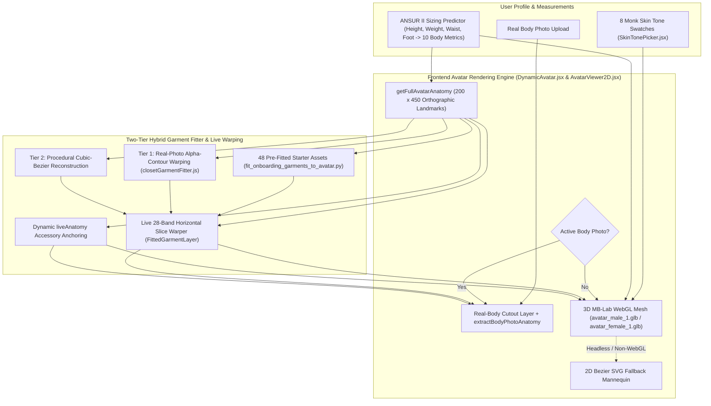

# DressApp — Архитектура динамического 3D-аватара и системы позиционирования виртуальной примерки (`Avatar.md`)

> **Версия документа:** 3.0  
> **Целевая подсистема:** Фронтенд 3D MB-Lab WebGL-аватар, сегментированные фотографии фигуры и движок анатомического наложения одежды  
> **Основные файлы:** `DynamicAvatar.jsx`, `AvatarViewer2D.jsx`, `closetGarmentFitter.js`, `SkinTonePicker.jsx`, `fit_onboarding_garments_to_avatar.py`, `onboardingDataset.js`  
> **Статус:** В продакшене и откалибровано  

---

## 1. Резюме и ценностное предложение

### 1.1 Обзор высокого уровня
**Система динамического 3D-аватара и позиционирования виртуальной примерки DressApp** обеспечивает адаптивную визуальную среду примерки в реальном времени. Она позволяет пользователям просматривать оцифрованные вещи из гардероба и базовые предметы стартовой капсулы, плавно наложенные либо на **сегментированную фотографию реальной фигуры**, либо на **реалистичную человеческую 3D-сетку MB-Lab** (`avatar_male_1.glb` и `avatar_female_1.glb`), отрендеренную через Three.js / React Three Fiber внутри откалиброванного ортографического окна `200 x 450` (с автоматическим переключением на резервный 2D-векторный SVG-манекен Безье).

Для достижения высокой визуальной точности во всех категориях одежды (топы, рубашки, верхняя одежда, брюки, юбки, традиционная/национальная одежда в пол, обувь и аксессуары) движок объединяет **точные ортографические 3D-ориентиры силуэта**, **двухуровневый гибридный алгоритм посадки одежды** и **живую горизонтальную полосовую деформацию (slice warping)**.

### 1.2 Ценность для пользователя
* **Реалистичные человеческие 3D-сетки MB-Lab**: Заменяет плоские 2D-силуэты реалистичными мужскими (`avatar_male_1.glb`) и женскими (`avatar_female_1.glb`) 3D-моделями, стоящими прямо в естественной A-стойке со слегка расставленными стопами и свободно опущенными руками с промежутком между ладонями и бёдрами.
* **Динамический морфинг фигуры и 8 оттенков кожи по шкале Монка**: Мгновенно реагирует на параметры пользователя (рост, вес, плечи, грудь, талия, бёдра) и 8 реалистичных оттенков человеческой кожи (`#F6EDE4` — `#3A2518`) с помощью физически корректного шейдера (`MeshPhysicalMaterial`).
* **Откалиброванные в 3D координаты одежды и аксессуаров**: Проецирует все 48 предметов стартовой капсулы и любые вещи из шкафа пользователя на точные координаты 3D-силуэта — включая разведённые руки (`wElbowOut`, `wWristOut`), ширину торса, ноги в A-стойке (`wOuterKnee`, `wOuterAnkle`) и расставленные стопы (`wFootTip`, `wFootHeel`).
* **Гибкость двойного аватара**: Мгновенное переключение между личной сегментированной фотографией в полный рост и динамическим 3D-аватаром в любое время.

---

## 2. Архитектура 3D-аватара (`DynamicAvatar.jsx`)

### 2.1 Ассеты Blender MB-Lab и калибровка ортографической камеры
* **Ассеты**:
  * Мужская сетка: `apps/web/public/models/avatar_male_1.glb` (`height = 1.7877 m`, смещение пола `ymin = -0.0061 m`)
  * Женская сетка: `apps/web/public/models/avatar_female_1.glb` (`height = 1.6873 m`, смещение пола `ymin = -0.0061 m`)
* **Ортографическая проекция**:
  * Рендерится через `<Canvas orthographic camera={{ zoom: 109, position: [0, 0, 5] }}>` внутри логического viewBox `200 x 450` (`aspect = 200 / 450`).
  * При `zoom = 109` масштаб составляет `1 метр = 109 единиц SVG`, размещая вертикальный центр холста высотой `450` единиц в точке `Y = 225`.
* **Независимое пропорциональное масштабирование (`Realistic3DAvatarMesh`)**:
  * Вертикальный масштаб (`scaleY`) вычисляется напрямую из `targetSvgHeight / (baseModelHeightM * 109)` и фиксируется на уровне стоп `yFeet` (`baseModelYMinM = -0.0061`), гарантируя точное вертикальное совпадение 1:1 с `getFullAvatarAnatomy` для любого роста (`140 см` — `210 см`).
  * Горизонтальный масштаб (`scaleX`, `scaleZ`) вычисляется независимо на основе взвешенных отношений `chest`, `waist`, `hip` и `shoulders` к базовым антропометрическим меркам (`scaleXZ`), благодаря чему изменение роста не приводит к искусственному расширению или сужению торса и конечностей.

### 2.2 Ортографические 3D-ориентиры силуэта (`getFullAvatarAnatomy`)
Путём растеризации треугольных сеток `avatar_male_1.glb` и `avatar_female_1.glb` в координатное пространство SVG `200 x 450` с вертикальным шагом в 1 единицу, функция `getFullAvatarAnatomy` формирует точные базовые ориентиры (динамически масштабируемые через `heightRatio` и коэффициенты обхватов):

| Группа ориентиров | Мужская база (`178 см`) | Женская база (`166 см`) | Назначение |
| --- | --- | --- | --- |
| **Вертикальные зоны торса** | `yChin: 58.5`, `yShoulders: 68.0`, `yChest: 100.0`, `yWaist: 138.0`, `yHip: 175.0`, `yCrotch: 190.0` | `yChin: 77.0`, `yShoulders: 87.0`, `yChest: 118.0`, `yWaist: 147.0`, `yHip: 185.0`, `yCrotch: 199.0` | Воротник, плечевой шов, грудь/бюст, пояс, таз и развилка шагового шва |
| **Вертикальные зоны конечностей** | `yElbow: 134.0`, `yWrist: 186.0`, `yKnees: 278.0`, `yAnkles: 356.0`, `yFeet: 382.0` | `yElbow: 148.0`, `yWrist: 195.0`, `yKnees: 282.0`, `yAnkles: 356.0`, `yFeet: 382.0` | Края коротких/три четверти/длинных рукавов, длина шорт/миди/до щиколотки и размещение обуви |
| **Полуширины торса** | `wNeck: 12.1`, `wShoulders: 38.6`, `wChest: 28.0`, `wWaist: 22.8`, `wHip: 25.8` | `wNeck: 10.5`, `wShoulders: 32.5`, `wChest: 24.4`, `wWaist: 19.6`, `wHip: 26.8` | Вырез горловины, наклон плеч, боковые швы торса и посадка по бёдрам |
| **Границы разведённых рук** | `wElbowOut: 49.0`, `wElbowIn: 32.8`, `wWristOut: 61.0`, `wWristIn: 47.2` | `wElbowOut: 41.2`, `wElbowIn: 28.8`, `wWristOut: 53.0`, `wWristIn: 42.8` | Наклонные коридоры рукавов и точки привязки запястья/часов/перчаток |
| **Границы ног в A-стойке и стоп** | `wOuterKnee: 33.8`, `wInnerKnee: 16.5`, `wOuterAnkle: 37.8`, `wInnerAnkle: 26.2`, `wFootTip: 42.2`, `wFootHeel: 24.0` | `wOuterKnee: 31.8`, `wInnerKnee: 16.2`, `wOuterAnkle: 36.2`, `wInnerAnkle: 26.0`, `wFootTip: 40.2`, `wFootHeel: 23.0` | Брючины, подол юбок и области левой/правой обуви |

---

## 3. Двухуровневый гибридный алгоритм посадки и живая полосовая деформация

### 3.1 Предварительно подогнанная стартовая капсула онбординга (`scripts/fit_onboarding_garments_to_avatar.py`)
* Генерирует все 48 прозрачных RGBA-вырезов (`*_fitted.png` и `.jpg` в разрешении $900 \times 1500$) в `apps/web/public/assets/onboarding/` вместе с метаданными `default_viewbox` и `point_cloud` в `apps/web/src/lib/onboardingDataset.js`.
* Использует `compute_avatar_geometry`, синхронизированную с `getFullAvatarAnatomy`, чтобы топы и верхняя одежда следовали коридорам разведённых 3D-рук (`wElbowOut`/`wWristOut`), брюки и джинсы — центрам ног в A-стойке (`legTopCenter` → `kneeCenter` → `ankleCenter`), юбки плавно расширялись поверх голеней, а парная обувь размещалась точно над `(FootHeel..FootTip, yAnkles..yFeet)`.

### 3.2 Рантайм-модуль посадки вещей из гардероба (`closetGarmentFitter.js`)
* **Анатомическая оболочка (`getGarmentAnatomicalEnvelope`)**: Вычисляет целевую ограничивающую рамку (`default_viewbox`) и анатомические ориентиры (`wElbowOut`, `wElbowIn`, `wWristOut`, `wWristIn`, `wOuterKnee`, `wInnerKnee`, `wOuterAnkle`, `wInnerAnkle`, `leftAnkleX`, `rightAnkleX`) для любой категории одежды.
* **Уровень 1 — Деформация альфа-контура реального фото (`warpRealGarmentPhotoToDefaultCanvas`)**:
  * Привязывает топы, рубашки, платья и верхнюю одежду к основанию шеи (`yNeckBase`) и ширине плеч (`shoulderSpan`) 3D-аватара, аккуратно укладывая рукава вдоль угла наклона 3D-рук.
  * Позиционирует брюки и юбки между `yWaist` и `yHip` в зависимости от типа посадки со строгим **барьером шагового шва (`yCrotchTarget >= yCrotch`)**, и направляет левую и правую штанины вдоль центров ног 3D-аватара в A-стойке от бедра до щиколотки.
  * Разделяет парные вырезы обуви (`analyzeFootwearCutout`) так, чтобы левая и правая туфли проецировались на `leftAnkleX` и `rightAnkleX` (`±(wFootTip + wFootHeel) / 2`).
* **Уровень 2 — Процедурная реконструкция кубическими кривыми Безье (`renderProceduralBezierFittedGarment`)**:
  * Резервный генератор силуэтов на основе кубических кривых Безье, привязанных к координатам рук, торса, ног и стоп 3D-аватара.

### 3.3 Живая горизонтальная полосовая деформация и привязка аксессуаров (`AvatarViewer2D.jsx`)
* **Горизонтальная полосовая деформация (`FittedGarmentLayer`)**:
  * Разделяет каждый подогнанный предмет одежды на `28` горизонтальных полос по высоте его `default_viewbox`.
  * Сопоставляет базовую вертикальную середину каждой полосы (`y0Mid`) с живой вертикальной позицией пользователя (`mapBaselineYToLiveY`) и коэффициентом горизонтальной ширины (`getLiveWidthScaleAtY`), динамически растягивая и позиционируя одежду для любого роста и комплекции.
* **Динамическая привязка аксессуаров через `liveAnatomy` (`renderGarment`)**:
  * **Головные уборы**: Центрируются по `X = 100`, привязываются к `yCrown` и `yHeadCenter` (`width = wHead * 2.55`).
  * **Очки**: Размещаются на уровне глаз (`yCrown + (yChin - yCrown) * 0.43`, `width = wHead * 1.95`).
  * **Серьги**: Размещаются от мочки уха (`yChin - 12` до `yChin + 10`, `width = wHead * 2.35`).
  * **Шарф / Шейный платок и Ожерелье / Галстук**: Привязываются к `yNeckBase` и масштабируются пропорционально `wNeck` / `wShoulders`.
  * **Ремень**: Центрируется на `yWaist + (yHip - yWaist) * 0.22` с шириной `width = wWaist * 2.18`.
  * **Часы / Браслет и Перчатки**: Привязываются к координатам разведённых 3D-запястий (`yWrist`, `wWristOut`).

---
*Документ поддерживается командой DressApp Engineering.*
