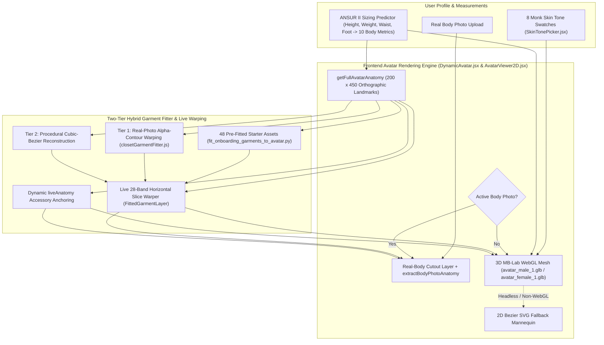

# DressApp — 3D 动态虚拟形象与虚拟试衣定位系统架构 (`Avatar.md`)

> **文档版本：** 3.0  
> **目标子系统：** 前端 3D MB-Lab WebGL 虚拟形象、真人全身照抠图与解剖学衣物叠穿引擎  
> **核心文件：** `DynamicAvatar.jsx`、`AvatarViewer2D.jsx`、`closetGarmentFitter.js`、`SkinTonePicker.jsx`、`fit_onboarding_garments_to_avatar.py`、`onboardingDataset.js`  
> **状态：** 已上线生产环境并完成校准  

---

## 1. 执行摘要与价值主张

### 1.1 高层概述
**DressApp 3D 动态虚拟形象与虚拟试衣定位系统**提供了一个自适应的实时可视化试衣环境。用户可以将数字化的衣橱单品和初始胶囊衣橱经典款无缝叠穿在**分割后的真人全身照**上，或叠穿在通过 Three.js / React Three Fiber 于校准后的 `200 x 450` 正交视图（viewBox）中渲染的**逼真 3D MB-Lab 人体网格模型**（`avatar_male_1.glb` 与 `avatar_female_1.glb`，带自动 2D 贝塞尔矢量 SVG 回退机制）之上。

为了在所有衣物类别（上装、衬衫、外套、长裤、半身裙、全身传统/民族服饰、鞋履及配饰）中实现极高的视觉精准度，该引擎结合了**精确的 3D 正交轮廓特征点**、**双层混合衣物拟合器**以及**实时水平切片变形（Slice Warping）**技术。

### 1.2 用户价值主张
* **逼真的 3D MB-Lab 人体网格模型**：用自然直立 A 字站姿（双脚微分，双臂自然垂于身体两侧且手掌与臀部之间留有适度空间）的逼真 3D 男性（`avatar_male_1.glb`）和女性（`avatar_female_1.glb`）网格模型取代扁平的 2D 剪影。
* **动态体型变形与 8 种 Monk 肤色**：通过基于物理的渲染材质（`MeshPhysicalMaterial`）着色器，实时响应用户的身材测量数据（身高、体重、肩宽、胸围、腰围、臀围）及 8 种逼真人类肤色（`#F6EDE4` 至 `#3A2518`）。
* **3D 校准的衣物与配饰坐标**：将全部 48 件初始胶囊衣橱单品及用户任意衣橱衣物精准映射到 3D 轮廓坐标上——包括微张的双臂（`wElbowOut`、`wWristOut`）、躯干宽度、A 字站姿双腿（`wOuterKnee`、`wOuterAnkle`）以及微分的双脚（`wFootTip`、`wFootHeel`）。
* **双模式虚拟形象自由切换**：可随时在个人分割全身照与 3D 动态虚拟形象之间无缝切换。

---

## 2. 3D 虚拟形象架构 (`DynamicAvatar.jsx`)

### 2.1 Blender MB-Lab 资源与正交相机校准
* **模型资源**：
  * 男性网格模型：`apps/web/public/models/avatar_male_1.glb`（`height = 1.7877 m`，地面偏移 `ymin = -0.0061 m`）
  * 女性网格模型：`apps/web/public/models/avatar_female_1.glb`（`height = 1.6873 m`，地面偏移 `ymin = -0.0061 m`）
* **正交投影**：
  * 在 `200 x 450` 逻辑 viewBox（`aspect = 200 / 450`）内通过 `<Canvas orthographic camera={{ zoom: 109, position: [0, 0, 5] }}>` 渲染。
  * 在 `zoom = 109` 下，`1 米 = 109 SVG 单位`，使 `450` 单位画布的垂直中心精准位于 `Y = 225`。
* **解耦式比例缩放 (`Realistic3DAvatarMesh`)**：
  * 纵向缩放（`scaleY`）直接由 `targetSvgHeight / (baseModelHeightM * 109)` 计算得出，并锚定在足底 `yFeet`（`baseModelYMinM = -0.0061`），确保在所有身高范围（`140 cm` 至 `210 cm`）内与 `getFullAvatarAnatomy` 保持 1:1 垂直对齐。
  * 水平缩放（`scaleX`、`scaleZ`）根据 `chest`、`waist`、`hip` 和 `shoulders` 相对于基准人体测量数据的加权比例（`scaleXZ`）独立计算，防止身高变化导致躯干和四肢被不自然地拉宽或压窄。

### 2.2 3D 正交轮廓特征点 (`getFullAvatarAnatomy`)
通过将 `avatar_male_1.glb` 和 `avatar_female_1.glb` 的三角形网格以 1 单位垂直间隔光栅化到 `200 x 450` SVG 坐标空间中，`getFullAvatarAnatomy` 提供了精确的基准特征点（由 `heightRatio` 与围度比例动态缩放）：

| 特征点分组 | 男性基准值 (`178 cm`) | 女性基准值 (`166 cm`) | 用途 |
| --- | --- | --- | --- |
| **躯干垂直区域** | `yChin: 58.5`, `yShoulders: 68.0`, `yChest: 100.0`, `yWaist: 138.0`, `yHip: 175.0`, `yCrotch: 190.0` | `yChin: 77.0`, `yShoulders: 87.0`, `yChest: 118.0`, `yWaist: 147.0`, `yHip: 185.0`, `yCrotch: 199.0` | 领口、肩缝、胸围、裤腰、骨盆及裤裆分叉点 |
| **四肢垂直区域** | `yElbow: 134.0`, `yWrist: 186.0`, `yKnees: 278.0`, `yAnkles: 356.0`, `yFeet: 382.0` | `yElbow: 148.0`, `yWrist: 195.0`, `yKnees: 282.0`, `yAnkles: 356.0`, `yFeet: 382.0` | 短袖/七分袖/长袖袖口、短裤/中长裙/及踝裤脚与鞋履定位 |
| **躯干半宽** | `wNeck: 12.1`, `wShoulders: 38.6`, `wChest: 28.0`, `wWaist: 22.8`, `wHip: 25.8` | `wNeck: 10.5`, `wShoulders: 32.5`, `wChest: 24.4`, `wWaist: 19.6`, `wHip: 26.8` | 领口开度、肩斜、躯干侧缝与臀部垂坠感 |
| **微张双臂边界** | `wElbowOut: 49.0`, `wElbowIn: 32.8`, `wWristOut: 61.0`, `wWristIn: 47.2` | `wElbowOut: 41.2`, `wElbowIn: 28.8`, `wWristOut: 53.0`, `wWristIn: 42.8` | 倾斜衣袖通道及手腕/手表/手套锚点 |
| **A 字站姿腿部与足部边界** | `wOuterKnee: 33.8`, `wInnerKnee: 16.5`, `wOuterAnkle: 37.8`, `wInnerAnkle: 26.2`, `wFootTip: 42.2`, `wFootHeel: 24.0` | `wOuterKnee: 31.8`, `wInnerKnee: 16.2`, `wOuterAnkle: 36.2`, `wInnerAnkle: 26.0`, `wFootTip: 40.2`, `wFootHeel: 23.0` | 裤管轮廓、裙摆及左右脚鞋履边界框 |

---

## 3. 双层混合衣物拟合器与实时切片变形

### 3.1 预拟合新手引导初始胶囊衣橱 (`scripts/fit_onboarding_garments_to_avatar.py`)
* 在 `apps/web/public/assets/onboarding/` 中生成全部 48 张透明 RGBA 抠图（分辨率为 $900 \times 1500$ 的 `*_fitted.png` 与 `.jpg`），并在 `apps/web/src/lib/onboardingDataset.js` 中生成对应的 `default_viewbox` 与 `point_cloud` 元数据。
* 使用与 `getFullAvatarAnatomy` 对齐的 `compute_avatar_geometry`，使上装/外套贴合 3D 微张手臂通道（`wElbowOut`/`wWristOut`），长裤/牛仔裤贴合 A 字站姿腿部中心线（`legTopCenter` → `kneeCenter` → `ankleCenter`），半身裙顺滑垂落于小腿外侧，成对鞋履精准定位于 `(FootHeel..FootTip, yAnkles..yFeet)` 之上。

### 3.2 运行时衣橱衣物拟合器 (`closetGarmentFitter.js`)
* **解剖学包络 (`getGarmentAnatomicalEnvelope`)**：为任意衣物类别计算目标边界框（`default_viewbox`）及解剖学特征点（`wElbowOut`、`wElbowIn`、`wWristOut`、`wWristIn`、`wOuterKnee`、`wInnerKnee`、`wOuterAnkle`、`wInnerAnkle`、`leftAnkleX`、`rightAnkleX`）。
* **第一层 — 真人照片 Alpha 轮廓变形 (`warpRealGarmentPhotoToDefaultCanvas`)**：
  * 将上装、衬衫、连衣裙和外套锚定到 3D 虚拟形象的颈根（`yNeckBase`）与肩宽（`shoulderSpan`），并沿 3D 手臂角度自然映射袖管。
  * 根据腰型（高腰、中腰、休闲腰或低腰）将长裤/半身裙定位在 `yWaist` 与 `yHip` 之间，执行严格的**裤裆屏障限制（`yCrotchTarget >= yCrotch`）**，并将左右裤腿从臀部到脚踝沿 3D 虚拟形象的 A 字站姿腿部中心线平移贴合。
  * 自动拆分双鞋抠图（`analyzeFootwearCutout`），使左右鞋分别精准映射到 `leftAnkleX` 与 `rightAnkleX`（`±(wFootTip + wFootHeel) / 2`）。
* **第二层 — 程序化三次贝塞尔重建 (`renderProceduralBezierFittedGarment`)**：
  * 绑定至 3D 虚拟形象手臂、躯干、双腿与足部坐标的三次贝塞尔路径回退轮廓生成器。

### 3.3 实时水平切片变形与配饰定位 (`AvatarViewer2D.jsx`)
* **水平切片变形 (`FittedGarmentLayer`)**：
  * 将每件拟合后的衣物在其 `default_viewbox` 内划分为 `28` 个水平切片（Slices）。
  * 将每个切片的基准垂直中点（`y0Mid`）映射到用户实时测量变形后的垂直位置（`mapBaselineYToLiveY`）和水平宽度比例（`getLiveWidthScaleAtY`），从而在所有身高与体型宽度下动态拉伸并精准定位衣物。
* **动态 `liveAnatomy` 配饰锚定 (`renderGarment`)**：
  * **帽饰**：居中于 `X = 100`，锚定至 `yCrown` 与 `yHeadCenter`（`width = wHead * 2.55`）。
  * **眼镜**：定位于眼部高度（`yCrown + (yChin - yCrown) * 0.43`，`width = wHead * 1.95`）。
  * **耳饰**：定位于耳垂区域（`yChin - 12` 至 `yChin + 10`，`width = wHead * 2.35`）。
  * **围巾 / 颈饰与项链 / 领带**：锚定于 `yNeckBase`，并按 `wNeck` / `wShoulders` 比例缩放。
  * **腰带**：居中于 `yWaist + (yHip - yWaist) * 0.22`，宽度为 `width = wWaist * 2.18`。
  * **手表 / 手链与手套**：锚定至微张的 3D 手腕坐标（`yWrist`、`wWristOut`）。

---
*文档由 DressApp Engineering 团队维护。*
