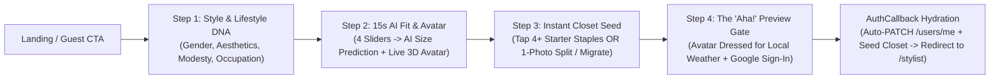

# Gradual Engagement & "Aha! Moment" Onboarding Strategy for DressApp

**Date:** 2026-10-19  
**Scope:** Product-Led Growth (PLG) Onboarding, Delayed Authentication ("Gradual Engagement"), Cold-Start Elimination, and Codebase Architecture Mapping (`apps/web`, `apps/mobile`, `backend`)

---

## 1. Executive Summary

Across consumer AI and digital wardrobe applications (**Whering, Indyx, Alta, Stitch Fix, Fits**), the two largest top-of-funnel drop-off points are:
1. **The Premature Authentication Wall:** Asking users to sign up before they have experienced any personalization or built psychological ownership (causing 40%–65% top-of-funnel bounce).
2. **The Empty-Closet "Cold Start" Paradox:** New users arrive seeking *consumption value* (seeing what to wear today, testing the AI Stylist, viewing outfits on their body avatar), but are immediately confronted with a *data-entry chore* (photographing, background-removing, and tagging dozens of garments).

By inverting the flow—collecting high-signal profile and style preferences **pre-authentication** via an interactive, visual wizard, demonstrating live AI body/avatar calibration, seeding a starter capsule so the closet isn't empty, and positioning **Google Sign-In** at the peak of psychological ownership—DressApp can turn sign-in into a natural "save my bespoke style & outfit" moment.

Remarkably, **DressApp's backend and frontend already contain almost all of the stateless primitives required to power this flow without backend re-architecture.**

---

## 2. Behavioral & UX Best Practices (Primary Industry Patterns)

### 2.1 Gradual Engagement & Delayed Sign-In
Coined by Luke Wroblewski (*Web Form Design* / *Mobile First*) and validated at scale by **Duolingo** (+20% Day-1 activation after delaying sign-up until after the first interactive lesson), **Noom**, and **Stitch Fix**:
- **Endowment Effect & Loss Aversion (Kahneman, Knetsch & Thaler, 1990):** Users value what they have co-created far more than an abstract marketing promise. Once a visitor spends 60 seconds selecting their aesthetic, watching their 3D avatar adapt to their proportions, and picking 4–5 staple garments, they mentally *own* their profile.
- **IKEA Effect & Sunk-Cost Momentum (Norton, Mochon & Ariely, 2012):** Interactive micro-commitments (single-question visual cards with an **Endowed Progress Bar** starting at ~15%) build momentum. Abandoning at the final step means losing their custom-calibrated avatar and their ready-to-view first outfit.
- **Zeigarnik Effect (Open Loop Resolution):** Computing the user's "Style DNA + Today's Weather Outfit Preview" right before the OAuth step creates cognitive tension that resolves the moment they click **"Continue with Google to Save & Reveal"**.

### 2.2 Defining DressApp's True "AHA! Moment"
In a digital wardrobe app, the **Aha! moment is NOT uploading a single shirt**.  
The **Aha! moment** is when the user sees **a complete, wearable head-to-toe outfit tailored to their body proportions, style aesthetic, and local weather—rendered on their personal avatar or outfit canvas—within 90 seconds of landing.**

### 2.3 Overcoming the Empty-Closet Cold Start (4 Proven Patterns)

| Cold-Start Pattern | How Leading Apps Execute It | How DressApp Can Apply It |
| :--- | :--- | :--- |
| **1. "Tap What You Own" Starter Capsule** *(Cladwell, Fits, Whering)* | Present a visual grid of 12–16 universal essentials matched to the user's gender & aesthetic (*White Tee, Navy Blazer, Straight Jeans, White Sneakers, Trench Coat*). User taps 4+ items they already own. | Zero camera friction on Minute 1. Seeds 4–6 items immediately so the AI Stylist and Outfit Canvas work right after sign-in. Tagged as `starter_capsule` so users can swap in real photos later. |
| **2. Instant Multi-Garment "1-Photo Outfit Split"** *(Alta, Fits)* | Instead of asking for 10 individual flat-lays, prompt the user to upload **1 mirror selfie (OOTD)** or **1 photo of 3–4 items laid on a bed**. | DressApp already has SegFormer-b2 multi-garment splitting ([`backend/app/services/clothing_parser.py`](../../backend/app/services/clothing_parser.py)) and U2-Net background matting ([`backend/app/services/background_matting.py`](../../backend/app/services/background_matting.py)). 1 photo = 1 complete outfit. |
| **3. Live AI Body & Avatar Calibration** *(Stitch Fix, Alta)* | Interactive sliders that visually morph a mannequin/avatar and predict exact garment sizes on the fly. | DressApp's `POST /api/v1/sizes/predict-measurements` ([`backend/app/api/v1/sizes.py`](../../backend/app/api/v1/sizes.py#L1477-L1553)) is **already public/stateless** and pairs directly with `<AvatarViewer />` ([`apps/web/src/components/AvatarViewer.jsx`](../../apps/web/src/components/AvatarViewer.jsx)). |
| **4. 1-Click Competitor Closet Migration** *(Indyx, Whering)* | Bifurcated path for power users switching from another wardrobe app. | DressApp already has [`OnboardingMigrationModal.jsx`](../../apps/web/src/components/OnboardingMigrationModal.jsx) (supporting Whering, Acloset, Stylebook, Smartli, BeautyAI). |

---

## 3. Codebase Audit: Current Flow vs. Existing Hooks in DressApp

### 3.1 Current Friction Points Identified in Source Code
1. **Hard Auth Gate on Primary CTAs ([`apps/web/src/App.js`](../../apps/web/src/App.js#L175-L193), [`ProtectedRoute.jsx`](../../apps/web/src/components/ProtectedRoute.jsx#L17-L19)):**
   - When a guest lands on [`Home.jsx`](../../apps/web/src/pages/Home.jsx) and clicks **"Ask AI Stylist"** (`/stylist`), **"My Closet"** (`/closet`), or **"Add Items to your Closet"** (`/closet/add`), `<ProtectedRoute />` immediately redirects them to `/login`.
   - [`Login.jsx`](../../apps/web/src/pages/Login.jsx#L55-L60) renders a static editorial photo with a single Google button that hardcodes `next="/home"`, discarding `location.state.from`.
2. **Mobile Hard Gate Before Any Value ([`apps/mobile/src/navigation/RootNavigator.tsx`](../../apps/mobile/src/navigation/RootNavigator.tsx#L86-L91)):**
   - Unauthenticated mobile users are locked into `AuthStack` (`LoginScreen` / `RegisterScreen`) before seeing any interactive style quiz, avatar preview, or sample closet.
3. **High-Value Profile Data Buried in a 10-Section Accordion ([`ProfileDetailsCard.jsx`](../../apps/web/src/components/ProfileDetailsCard.jsx#L125-L164)):**
   - Critical personalization signals used by the AI Stylist (`sex`, `occupation`, `style_profile.aesthetics`, `style_profile.color_palette`, `style_profile.avoid`, `cultural_context.dress_conservativeness`, `skin_tone`, and `body_measurements`) live inside `/me` (`Profile.jsx`), which most new users do not complete before trying (and failing) to use an empty closet.
4. **Broken Route in Post-Login Reminder Modal ([`LoginClosetReminderModal.jsx`](../../apps/web/src/components/LoginClosetReminderModal.jsx#L33-L36)):**
   - Clicking **"Let's start"** in `LoginClosetReminderModal.jsx` calls `nav('/upload')`, which is not a registered route in [`App.js`](../../apps/web/src/App.js) (the actual route is `/closet/add`), causing the wildcard `<Route path="*" element={<Navigate to="/home" replace />} />` to bounce the user back to `/home`.

### 3.2 Existing DressApp Primitives Ready for Pre-Auth Onboarding
DressApp's architecture is uniquely well-suited for pre-auth gradual engagement because the hardest components are **already built and unauthenticated**:

| Capability | Existing Source File & Endpoint | Pre-Auth Readiness |
| :--- | :--- | :--- |
| **Stateless AI Body Measurement & Size Predictor** | [`backend/app/api/v1/sizes.py`](../../backend/app/api/v1/sizes.py#L1477-L1553) (`POST /api/v1/sizes/predict-measurements`) | **100% Ready.** Explicitly documented as *"Stateless, no auth required — can be called during onboarding before the user has an account."* Takes `height`, `weight`, `waist`, `foot_length`, `gender` and returns 6 predicted dimensions + 5 recommended sizes. |
| **Real-Time 3D/2D Morphing Avatar** | [`apps/web/src/components/AvatarViewer.jsx`](../../apps/web/src/components/AvatarViewer.jsx) & [`apps/mobile/src/components/DynamicAvatarSvg.tsx`](../../apps/mobile/src/components/DynamicAvatarSvg.tsx) | **100% Ready.** Purely prop-driven (`measurements`, `sex`, `skinColor`, `outfitItems`); morphs live on the client without auth. |
| **Local Weather Forecast** | [`backend/app/api/v1/weather.py`](../../backend/app/api/v1/weather.py) (`GET /api/v1/weather`) | **100% Ready.** Already called by guests on `Home.jsx` to show local temperature and conditions. |
| **Anonymous Funnel Telemetry** | [`backend/app/api/v1/users.py`](../../backend/app/api/v1/users.py#L643-L658) (`POST /api/v1/users/funnel-event`) | **100% Ready.** Uses `Depends(get_current_user_optional)` so pre-auth onboarding step completion rates can be logged with `user_id: None`. |
| **Google OAuth + People API + 5 Free Credits** | [`backend/app/api/v1/google_auth.py`](../../backend/app/api/v1/google_auth.py#L790-L886) | **100% Ready.** Automatically pulls name, avatar, locale, DOB/gender/location (when available) from Google People API, grants **5 free AI credits**, and redirects to `/auth/callback#token=...&next=...`. |
| **Pre-Auth Local Storage Bridge** | [`App.js`](../../apps/web/src/App.js#L120-L133) (`dressapp_ref_id`) & [`AuthCallback.jsx`](../../apps/web/src/pages/AuthCallback.jsx#L55-L77) | **Pattern Established.** Just as `dressapp_ref_id` and `dressapp.lang` survive the Google OAuth redirect via `localStorage`, a structured `dressapp.onboarding_draft` object can be flushed via `api.patchMe()` in `AuthCallback.jsx`. |

---

## 4. Recommended 4-Step "Gradual Engagement" Onboarding Plan

### Overview Flow Diagram



### Step-by-Step Specification

#### Step 1: Style & Lifestyle DNA (15–20 seconds, Zero Typing)
- **Goal:** Low-friction micro-commitment using visual cards/chips (Endowed Progress Bar starts at **20%**).
- **Inputs Collected (maps 1:1 to `User` schema in [`useProfileForm.js`](../../apps/web/src/components/profile/useProfileForm.js)):**
  - `sex`: Feminine / Masculine (`female` | `male`)
  - `style_profile.aesthetics`: Tap 2–3 visual vibe cards (*Minimalist, Smart-Casual, Streetwear, Old Money, Boho, Athleisure, Chic*)
  - `cultural_context.dress_conservativeness`: Visual toggle (*Relaxed/Low, Balanced/Moderate, Modest/High*)
  - `occupation`: Quick-pick chips (*Corporate/Office, Creative/Tech, Student, Remote/Home, Active/On-the-Go, Fashion Professional*)

#### Step 2: The First Mini-"Aha!" — Live AI Body & Avatar Calibration (20 seconds)
- **Goal:** Deliver immediate interactive AI magic before asking for any credentials (Progress Bar at **50%**).
- **Interaction:**
  - User adjusts 4 simple sliders/inputs: **Height**, **Weight**, **Waist**, and **Foot Length** (with instant `cm/kg` ↔ `in/lb` toggle) + **Skin Tone** swatch picker ([`SkinTonePicker.jsx`](../../apps/web/src/components/SkinTonePicker.jsx)).
  - Debounced call to stateless `POST /api/v1/sizes/predict-measurements` computes **Shoulders, Chest, Hips, Sleeve, Inseam, Outseam** + **Recommended Shirt, Pants, Dress & Shoe Sizes** in <200ms.
  - `<AvatarViewer />` morphs in real time alongside a badge: *"✨ AI Fit Calibrated: Shirt M · Pants 32 · 6 Body Dimensions Mapped"*.

#### Step 3: Solving the Cold Start — "Tap What You Own" Starter Capsule (20 seconds)
- **Goal:** Guarantee that the user's closet has **at least 4–6 items** before they ever enter the app (Progress Bar at **80%**).
- **Primary Path ("60-Second Starter Capsule"):**
  - Display a curated grid of 12 staple garments filtered by their Step 1 `sex` and `aesthetics` (reusing DressApp's existing studio cutouts & curated images).
  - Prompt: *"Tap at least 4 basics you already own in real life so your AI Stylist can build outfits right now (you can swap in your own photos anytime)."*
- **Secondary Power-User Path:**
  - Pill link at bottom: *"Already use Whering, Acloset, or Stylebook? Import my closet in 1 click after sign-in"* (sets `migration_flag: "Migrate"` in the draft).

#### Step 4: The "Aha! Moment" Reveal + Natural Google Sign-In (Progress Bar at **95%**)
- **What the User Sees:**
  - A personalized summary card showing:
    1. Their **calibrated 3D/2D Avatar** dressed in a **complete outfit assembled from the staples they just tapped**, matched to their **real local weather** (via `GET /api/v1/weather`, e.g., *"Tomorrow in Tel Aviv: 21°C · Smart-Casual Layer"*).
    2. Their computed **AI Size Passport** (`Shirt`, `Pants`, `Shoes`) & **Style DNA tags**.
    3. A teaser for their **+5 Free AI Styling & Try-On Credits** waiting in their account.
- **The Natural Sign-In Prompt:**
  - Headline: **"Your Style Profile & First Outfit Are Ready!"**
  - Subheadline: **"Sign in with Google in 1 tap to save your calibrated avatar, starter closet, and claim your 5 free AI credits."**
  - Action: `<GoogleAuthButton next="/stylist?onboarded=1" />`
  - Escape Hatch: *"Already have an account? Sign in"* (top-right subtle link).

---

## 5. Technical Implementation Blueprint

1. **Client-Side Draft Store (`apps/web/src/lib/onboardingStore.js` & Mobile `AsyncStorage`):**
   - Persist `dressapp.onboarding_draft` in `localStorage` as the user advances through Steps 1–3:
     ```json
     {
       "sex": "female",
       "occupation": "Creative / Tech",
       "units": { "weight": "kg", "length": "cm" },
       "skin_tone": "#D2A679",
       "body_measurements": { "height": 168, "weight": 60, "waist": 68, "foot_length": 24.5, "shoulders": 39.2, "chest": 88.5, "hip": 95.0, "sleeve": 58.0, "inseam": 76.5, "outseam": 101.0, "shirt_size": "S", "pants_size": "27" },
       "style_profile": { "aesthetics": ["minimalist", "smart_casual"], "color_palette": ["neutral", "earth_tones"], "avoid": [] },
       "cultural_context": { "dress_conservativeness": "moderate" },
       "starter_item_ids": ["staple_white_shirt", "staple_navy_blazer", "staple_charcoal_trousers", "staple_oxford_shoes"],
       "migration_flag": "No"
     }
     ```
2. **Post-OAuth Auto-Hydration in [`AuthCallback.jsx`](../../apps/web/src/pages/AuthCallback.jsx):**
   - Immediately after `tokenStore.set(token)` and `refresh()` in `AuthCallback.jsx`:
     - Check for `localStorage.getItem('dressapp.onboarding_draft')`.
     - If present, fire `api.patchMe(...)` to save all profile/measurement/style fields without overwriting existing fields if an existing user logged in.
     - Seed selected `starter_item_ids` into the user's closet (marked with `source: "starter_capsule"` or a badge so they know they can replace them with real photos later) and clear `dressapp.onboarding_draft`.
     - Redirect directly to `/stylist?onboarded=1` (or `/home` with their first outfit already active).
3. **Quick-Win Bug Fixes Along the Way:**
   - Fix [`LoginClosetReminderModal.jsx`](../../apps/web/src/components/LoginClosetReminderModal.jsx#L35) where `nav('/upload')` points to a non-existent route instead of `nav('/closet/add')`.
   - Update [`Login.jsx`](../../apps/web/src/pages/Login.jsx#L56) and [`Register.jsx`](../../apps/web/src/pages/Register.jsx#L58) so `<GoogleAuthButton />` reads `location.state?.from?.pathname` (or `?next=`) instead of always hardcoding `next="/home"`.

---

## 6. Locked Design Decisions (`/grill-me` Alignment — 2026-10-19)

1. **Entry Point & Routing Architecture:**
   - Keep `/home` as the public showcase.
   - Route all `"Get Started"`, `"Create Account"` (`/register`), and guest clicks on protected-feature CTAs (via [`ProtectedRoute.jsx`](../../apps/web/src/components/ProtectedRoute.jsx)) into the new `/onboarding` wizard (preserving `state.from` as the intended destination).
   - Keep `/login` as a fast, direct 1-click Google Sign-In for returning users.
2. **Step 3 Closet Seeding — Men's & Women's Static Onboarding Datasets (`onboardingDataset.js`, Mode B Disabled):**
   - **48-Item Static Dataset (24 Women's + 24 Men's):** Divided into Men's and Women's collections covering the full spectrum of global silhouettes aligned with [`AvatarViewer2D.jsx`](../../apps/web/src/components/AvatarViewer2D.jsx) topography:
     - *Women's (24 items):* Full-Body Cultural & One-Piece (*Embroidered Kaftan, Flowing Jalabiya/Galabiya, Classic Abaya, Midi Wrap Dress, Long-Sleeve Modest Maxi Dress, Tailored Jumpsuit*), Skirts (*Pleated Maxi Skirt, A-Line Midi Skirt, Tailored Pencil Skirt*), Trousers & Loose Pants (*Tailored Suit Trousers, Wide-Leg Linen Palazzo Pants, Straight Jeans, Athleisure Joggers*), Tops & Loose Tunics (*Longline Linen Tunic/Overshirt, Crisp White Button-Down, High-Neck Silk Blouse, Crewneck Tee*), Suits & Outerwear (*Navy Business Suit Blazer, Belted Trench Coat, Fine-Knit Cardigan*), and Footwear (*White Sneakers, Closed-Toe Block-Heel Pumps, Leather Loafers/Flats, Boots/Sandals*).
     - *Men's (24 items):* Full-Body Traditional & Tailored Suits (*Traditional Thobe/Dishdasha, Relaxed Jalabiya/Djellaba, Longline Linen Kurta/Tunic, Two-Piece Navy Business Suit, Double-Breasted Blazer*), Tops & Loose Layers (*Crisp Oxford Dress Shirt, Loose Linen Overshirt, Merino Crewneck Sweater, Piqué Polo, Essential Cotton Tee, Streetwear Hoodie*), Trousers & Loose Pants (*Tailored Wool Dress Trousers, Wide-Leg Linen Drawstring Pants, Sand Chinos, Straight Denim Jeans, Athletic Joggers*), Outerwear (*Hopsack Blazer, Wool Overcoat, Bomber Jacket, Suit Waistcoat*), and Footwear (*Oxford Dress Shoes, White Leather Sneakers, Suede Loafers, Chelsea Boots*).
   - **Dual-Path Outfit Completeness:** Step 3 & Step 4 validate a complete outfit via **either** the **Full-Body Path** (`1 Full-Body [Dress / Kaftan / Jalabiya / Thobe / Abaya / Jumpsuit] + 1 Footwear`, 4+ items total) **or** the **Separates/Suit Path** (`1 Top + 1 Bottom [Trousers or Skirt] + 1 Footwear`, 4+ items total).
   - **Mode B Disabled:** No single-photo camera/selfie upload in Step 3.
   - **Mode C (Power-User Pill):** *"Migrating from Whering / Acloset / Stylebook? Import in 1 click"* (`migration_flag: "Migrate"`).
3. **Starter Capsule Lifecycle & Marketplace Guardrails:**
   - Mark Starter Capsule items with a `starter_capsule` tag/flag and display a subtle *"Starter Basic — Tap to snap your real photo"* badge on the card.
   - Allow the AI Stylist, Outfit Canvas, and Suitcase to use them immediately.
   - Block publishing `starter_capsule` items to the Marketplace until the user replaces the stock cutout with their own real photo via `POST /api/v1/closet/{item_id}/photo` ([`set_item_photo`](../../backend/app/api/v1/closet/ingestion.py#L1751)).
4. **Step 1 & Step 2 Profile Scope + B2B Professional Branch:**
   - **Step 1 (Style & Lifestyle DNA):** Visual, zero-typing cards/chips for `sex`, `style_profile.aesthetics`, `style_profile.color_palette`, `cultural_context.dress_conservativeness`, `occupation`, **plus** an *"Are you a Professional Stylist / Tailor / Designer?"* toggle (`professional.is_professional`).
   - **Step 1B (Conditional B2B Professional Card):** When the Professional toggle is enabled, show a compact Business Card step (`profession` chip, `business.name`, `business.address`/city, `business.website`/Instagram, `business.description`).
   - **Step 2 (AI Fit & Avatar Calibration):** 4 interactive sliders (`height`, `weight`, `waist`, `foot_length` with `cm/kg` ↔ `in/lb` toggle) + `skin_tone` picker, calling stateless `POST /api/v1/sizes/predict-measurements` live and morphing [`AvatarViewer.jsx`](../../apps/web/src/components/AvatarViewer.jsx).
   - Let Google OAuth auto-fill Name, Email, Avatar, DOB, and Location on sign-in; defer Phone, Full Street Address, Hair, and PayPal payout fields to `/me`.
5. **Step 4 "Aha! Moment" Reveal & Post-OAuth Landing Destination:**
   - **Step 4 Reveal:** Show the user's calibrated **3D/2D Avatar** wearing a complete head-to-toe outfit assembled from their selected Starter Capsule items, matched to their **real local weather** (`GET /api/v1/weather`), alongside their **AI Size Passport** (and a live preview of their **Experts Directory Card** if they enabled the Professional toggle).
   - **Post-OAuth Landing:** After [`AuthCallback.jsx`](../../apps/web/src/pages/AuthCallback.jsx) flushes the onboarding draft and seeds their closet, land them directly in `/stylist` with their newly generated first outfit loaded on the canvas and a welcome message from the AI Stylist (or honor the specific feature route they originally clicked if it wasn't `/stylist` or `/home`).
6. **Direct `/login` New Users & Existing Account Collision Handling:**
   - If a user signs in directly via `/login` and has **0 closet items + no style/measurement profile yet**, route them into `/onboarding` (in authenticated mode) instead of showing the legacy empty-closet popup in [`AppLayout.jsx`](../../apps/web/src/components/AppLayout.jsx).
   - If an existing user with saved data completes `/onboarding` as a guest before signing into their existing Google account, **merge non-destructively** (only populate empty profile fields and append newly selected starter items).
7. **Rollout Sequence:**
   - Build and ship **Web (`apps/web`) + Backend (`backend`) + 13 Locales + HelpMenu/Wiki docs** first as the reference implementation, then port the flow to **Mobile (`apps/mobile`)**.

